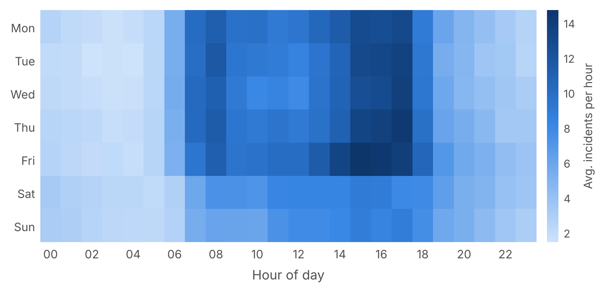

# Manuscript draft

**Locating freeway service patrol stations with deep spatio-temporal incident forecasting: a predict-then-optimise study of FDOT District 2, Northeast Florida**

Pascal Antwi¹, [Co-author] Sando²
¹ [Affiliation] · ² [Affiliation] · Corresponding author: [name, email]

*Outline draft, 21 October 2026. Introduction, literature review, discussion and conclusion are bullet outlines to be written up. The exploratory analysis ([Section 4](#sec-4)), modelling methods ([Section 5](#sec-5)) and modelling results ([Section 6](#sec-6)) are drafted; results are reported without interpretation. Items still waiting on data are marked [pending]. All figures and tables are in the appendices: [Appendix A](#appendix-a-figures) (figures), [Appendix B](#appendix-b-tables) (tables), [Appendix C](#appendix-c-supplementary-material) (supplementary).*

**Terminology.** The data are traffic management events, not Road Ranger dispatch records. "Incidents" means events of the four types Road Rangers serve (disabled vehicle, crash, debris on roadway, abandoned vehicle); whether a Road Ranger responded to a given incident is not recorded.

---

## Abstract (outline, about 250 words; write last)

- **Background:** freeway service patrols such as Road Rangers cut clearance time and secondary crashes, but station locations are rarely derived from incident data.
- **Objective:** forecast where and when incidents occur, and locate patrol stations to maximise timely coverage.
- **Data:** 9.2 million traffic management records (2022–2024, FDOT District 2) reconstructed into 227,196 events; 173,198 incidents.
- **Methods:** network hotspot detection; spatio-temporal graph neural network (GNN) forecasting against statistical and machine-learning baselines; maximal covering and p-median models fed with predicted demand; evaluation on 2024.
- **EDA findings:** 90.3% of incidents on five corridors; half in 14.8% of occupied 1 km cells; weekday 15:00–17:59 peak; crash events open about four times longer than other types.
- **Modelling results:** 35 significant hot cells in eight clusters, all in Duval County; LightGBM and a Poisson log-linear model most accurate, deep models 0.45–0.69% higher deviance; 10 optimised stations cover 90.8% of 2024 incidents within 15 minutes (day-ahead staging 91.5–91.7%; oracle 99.1%); [pending] comparison with current stations.
- **Keywords:** freeway service patrol; traffic incident management; graph neural network; spatio-temporal forecasting; maximal covering location problem; Florida.

## 1. Introduction (outline)

1. **Problem.** Incidents cause non-recurrent congestion; each minute on the roadway raises secondary-crash risk [REF].
2. **Service patrols.** Road Rangers' role in FDOT's traffic incident management; evidence of benefits [REF].
3. **Gap.** Station locations follow practice. Hotspot studies stop at the map, and forecasting studies stop at accuracy metrics without testing whether forecasts improve deployment decisions.
4. **Aim and objectives.** (i) Characterise incident patterns; (ii) forecast incident demand on the network with deep learning; (iii) optimise station locations with forecast demand; (iv) test whether forecast-driven layouts cover more future incidents than historical-demand and current layouts.
5. **Contribution.** A predict-then-optimise framework evaluated on a decision metric (incidents covered), not only forecast error, plus an assessment of detection bias in patrol-generated records.
6. **Paper structure.**

## 2. Literature review (outline, 40–60 references)

### 2.1 Freeway service patrols
- Effects on detection, response and clearance; secondary crashes; benefit–cost evaluations [REF].

### 2.2 Incident hotspot detection
- Network vs planar kernel density (Xie and Yan, 2008; Okabe et al., 2009); Gi* (Getis and Ord, 1992); counts vs exposure-based rates.

### 2.3 Deep learning for traffic and incident forecasting
- Spatio-temporal graph models: DCRNN (Li et al., 2018), STGCN (Yu et al., 2018), Graph WaveNet (Wu et al., 2019).
- Accident risk prediction under sparsity: Hetero-ConvLSTM (Yuan et al., 2018) [add recent incident/crash risk studies].
- Evidence that gradient boosting (Ke et al., 2017) is a strong baseline on sparse tabular data.

### 2.4 Facility location for emergency response
- Set covering (Toregas et al., 1971), maximal covering (Church and ReVelle, 1974), p-median (Hakimi, 1964); time-varying and predict-then-optimise approaches [REF].

### 2.5 Research gap
- No study links network incident forecasts from deep learning to service-patrol station siting and evaluates the result on held-out incidents.

## 3. Data (outline)

### 3.1 Study area 
- FDOT District 2: 15 counties; Jacksonville, Gainesville, Lake City; I-75, I-95, I-10, I-295 beltway → [Figure 1](#figure-1).

### 3.2 Incident data 
- Traffic management event chronology export, 1 Jan 2022 – 31 Dec 2024; one record per update to an event [REF: data owner, permission].
- Processing: duplicates removed; timestamps parsed in UTC and converted to Eastern time; coordinates rescaled from micro-degrees; points outside Florida removed; one row per event (type and conditions from the first record, location from the latest); roadway text parsed into county, route, direction, mile marker; duration = first to last update, with < 1 min and > 24 h flagged.
- Analysis sample: the four types Road Rangers serve → [Table 1](#table-1).

### 3.3 Supplementary data 
- Road network: OpenStreetMap (Boeing, 2017). Traffic volume: FDOT AADT. Weather: NOAA hourly observations. Holidays: federal and state calendar.
- Candidate station sites: interchanges, rest areas, FDOT facilities. Current Road Ranger stations and beats: FDOT District 2 [to obtain].

## 4. Exploratory data analysis 

Incidents were aggregated by month, weekday and hour, and mapped to a 1 km grid (incidents per year, crash share and most frequent location per cell) and to hexagonal density bins on a logarithmic scale. Candidate covariates were screened for completeness and variation.

### 4.1 Sample characteristics 

Between 1 January 2022 and 31 December 2024, 227,196 unique events were recorded in District 2, reconstructed from 9,206,764 chronology records ([Table 1](#table-1)). The four incident types served by Road Rangers made up 173,198 events (76.2%). The remaining events were traffic-management notices, chiefly congestion (22,053), scheduled road work (12,658) and bridge openings (4,392) ([Figure S1](#figure-s1)). Disabled vehicles were the most frequent type (58.9%), followed by crashes (25.5%), debris (9.8%) and abandoned vehicles (5.8%) ([Table 2](#table-2)). Annual totals varied by less than 7% (56,450 to 59,981), with no sustained trend in any type ([Figure S2](#figure-s2)).

**Interpretation.** Patrol-relevant demand is dominated by non-crash assistance: disabled vehicles outnumber crashes by more than two to one ([Table 2](#table-2)), so planning from crash data alone would miss most of the workload. The stability in [Figure S2](#figure-s2) supports training on 2022–2023 and testing on 2024 ([Section 5.6](#sec-5-6)).

### 4.2 Temporal patterns 

Weekdays accounted for 76.2% of incidents, and the mean daily count was 28% higher on weekdays than at weekends (168.7 vs 131.5) ([Table 2](#table-2)). Incidents peaked between 15:00 and 17:59 on weekdays, with a maximum on Fridays from 15:00 to 15:59 (14.7 per hour), against about two per hour between 01:00 and 04:59 ([Figure 2](#figure-2)). Crashes had a morning peak at 07:00 (5.9%) and a larger evening peak at 17:00 (9.0%). Debris showed a midday plateau (09:00–16:00), and abandoned vehicles clustered at 07:00–08:59 (24.6%) ([Figure S3](#figure-s3)).

**Interpretation.** The afternoon peak in [Figure 2](#figure-2) coincides with commuter traffic, consistent with exposure rather than time of day driving occurrence. The roughly sevenfold gap between overnight and peak demand motivates time-of-day forecasting and band-specific staging ([Sections 5.2](#sec-5-2) and [5.5](#sec-5-5)). The morning spike in abandoned vehicles ([Figure S3](#figure-s3)) most plausibly reflects detection on first patrols rather than when vehicles were abandoned.

### 4.3 Spatial distribution and concentration 

Incidents were confined to the limited-access network and concentrated around Jacksonville ([Figure 1](#figure-1)a); Duval County accounted for 53.2%. Five routes, I-75 (26.3%), I-95 (22.3%), I-10 (18.5%), I-295 W (14.4%) and I-295 E (8.8%), carried 90.3% ([Figure S4](#figure-s4)). Crashes made up 34.8% of incidents on I-95 but 8.9% on I-75, where disabled vehicles accounted for 76.0%. Of the 983 occupied 1 km cells, 145 (14.8%) contained half of all incidents, and the 15 busiest contained 9.9% ([Figure 3](#figure-3)). Fourteen of the top 15 cells lie in central Jacksonville in four clusters: the Buckman Bridge (I-295 W), the I-95/I-10 interchange, I-95 at Butler Boulevard and I-295 E at Butler Boulevard ([Figure 1](#figure-1)b). Interchange cells had crash shares of 40–48%, whereas bridge and rural cells (the Buckman Bridge and I-75 near Gainesville) had 6–11% ([Figure 3](#figure-3)).

**Interpretation.** The concentration in [Figure 3](#figure-3) is the precondition for coverage-based siting: a few stations can reach a large share of demand. The contiguous clusters in [Figure 1](#figure-1)b suggest each cluster acts as one service zone, and spatial dependence between neighbouring segments is what a graph model is designed to exploit ([Section 5.4](#sec-5-4)). Crash-dominated interchanges call for rapid clearance; bridge and rural hotspots call for fast removal. These planar results are descriptive; network significance and AADT normalisation follow in [Section 6.1](#sec-6-1).

### 4.4 Event duration 

The median event duration was 18.9 minutes (IQR 5.7–45.6) ([Table 2](#table-2)). Crash events remained open for a median of 56.7 minutes, about four times longer than disabled vehicles (13.4) and debris (12.8); abandoned vehicles were shortest at 4.7 minutes ([Figure 4](#figure-4)). The 5,189 flagged events (3.0%) were excluded ([Table 1](#table-1)).

**Interpretation.** Crash events occupy units about four times longer ([Figure 4](#figure-4)), so crash-dominated hotspots consume more capacity than their counts imply, which motivates a duration-weighted demand scenario ([Section 5.6](#sec-5-6)). Duration is a log-based proxy for how long an event stayed open, not on-scene clearance time.

### 4.5 Data quality and detection 

Half of all incidents (49.8%) were created by the account `avlrrsubsystem`, which appears to be the Road Ranger automatic vehicle location (AVL) subsystem [to confirm with FDOT] ([Table S1](#table-s1)). Its share ranged from 4.9% of crashes to 86.8% of abandoned vehicles ([Table 2](#table-2)), and from 35% on I-95 to 73% on I-75. Severity was recorded as minor for 99.9% of incidents, pavement as dry for 98.8% and weather as clear for 98.3%; mile markers were missing for 53.0% ([Table S1](#table-s1)). Recorded adverse conditions were concentrated in crash records: 87.3% of incidents recorded in rain and 84.5% of those recorded on wet pavement were crashes, against 25.5% of all incidents. Lighting computed from solar position classified 74.9% of incidents as daylight, 3.4% as twilight and 21.7% as dark; the recorded lighting code 16 accounted for 94.7% of daylight and 81.5% of dark incidents. In total, 3,117 incidents (1.8%) had another incident on the same route and direction within 0.5 km and 15 minutes (near-duplicates; [Table S1](#table-s1)); they were retained and tested in sensitivity analyses.

**Interpretation.** If confirmed as patrol-generated, the AVL share in [Table 2](#table-2) means many non-crash incidents are discovered by patrols themselves, so recorded demand may partly mirror existing patrol coverage (detection bias); crashes, rarely AVL-created, are less exposed. Hotspot and station analyses were therefore repeated without these records ([Section 5.6](#sec-5-6)). The recorded severity, weather and lighting fields in [Table S1](#table-s1) are not used as model inputs; darkness is derived from solar position, and NOAA weather is to be added ([Section 3.3](#sec-3-3)).

## 5. Methodology: modelling 

### 5.1 Framework 
- The analysis follows the predict-then-optimise pipeline in [Figure 5](#figure-5). The OpenStreetMap network, FDOT AADT and NOAA weather could not yet be obtained, so the implementation uses road cells derived from the incident data. Inputs still to be added are marked [pending].

### 5.2 Spatial and temporal units 
- **Road cells:** 983 cells of 1 km × 1 km containing at least one incident in 2022–2024; incident locations trace the limited-access network ([Figure 1](#figure-1)). [pending: replace with directional 0.5-mile OpenStreetMap segments.]
- **Model graph:** each cell linked to its occupied eight neighbours (1,583 links).
- **Travel graph:** cells linked when centroids are ≤ 3 km apart; the largest connected component contains 945 cells and 99.8% of incidents.
- **Time:** 8,768 three-hour windows; mean 0.020 incidents per cell-window; 98.1% of cell-windows have no incident.

### 5.3 Hotspot detection 
- Getis-Ord Gi* (Getis and Ord, 1992) on mean annual incidents per cell, with binary weights for cells within 2 km (cell included); two-sided p-values adjusted for the false discovery rate (Benjamini and Hochberg, 1995); classes at q < 0.01, 0.05 and 0.10; "hot" denotes q < 0.05.
- Persistence: Gi* recomputed for each calendar year; number of years a cell is hot.
- Robustness: Gi* recomputed excluding AVL-created incidents, excluding near-duplicates, and for crashes only; agreement measured as the share of baseline hot cells retained and the Jaccard index.
- [pending: network kernel density estimation (Okabe et al., 2009) and AADT-based rates.]

### 5.4 Demand forecasting 
- **Task:** day-ahead. At the start of day *d*, predict incidents in each of the eight windows of day *d* for all 983 cells, using data up to the end of day *d* − 1.
- **Split:** training 29 January 2022 – 30 September 2023 (610 days; the first 28 days of 2022 serve as history), validation 1 October – 31 December 2023 (92 days), test 1 January – 31 December 2024 (366 days).
- **Inputs** ([Table S2](#table-s2)): historical mean per cell, window and day type (weekday vs weekend or federal holiday; training days only); counts in the same window 1 and 7 days earlier; cell totals over the previous 1, 7 and 28 days; neighbouring cells' 7-day total; district total on the previous day; window, weekday, month and holiday indicators; share of the window in darkness (solar position); cell coordinates. [pending: NOAA precipitation; AADT.]
- **Baselines:** (i) historical average; (ii) Poisson log-linear model with cell, window × day type and month main effects, fitted by iterative proportional fitting (equivalent to Poisson maximum likelihood); (iii) LightGBM (Ke et al., 2017) with a Poisson objective and early stopping on the validation set.
- **Deep learning models.** All three share a prediction head that combines a learned cell representation with the window-level inputs and outputs a log-rate offset by the logarithm of the historical mean; the loss is the Poisson negative log-likelihood.
    - *LSTM* (no graph; ablation): one LSTM layer per cell over the last 16 windows.
    - *Graph WaveNet* (Wu et al., 2019): four gated dilated temporal convolution layers (dilations 1, 2, 4, 8) with diffusion graph convolution over the cell graph (one- and two-step transitions) and an adaptive adjacency learned from cell embeddings.
    - *Spatio-temporal Transformer:* temporal self-attention over the last 16 windows of each cell, followed by spatial self-attention across all 983 cells.
- **Training:** Adam (learning rate 0.001), batches of 8 days, at most 20 epochs with early stopping on validation deviance (patience 3); hyperparameters in [Table S2](#table-s2).
- **Replication:** five random seeds for LightGBM and each deep model; results reported as mean ± standard deviation.
- **Metrics (2024):** MAE, RMSE and mean Poisson deviance over cell-windows; daily hit rate (share of the day's incidents in the 5% of cells with the highest predicted daily demand) and predictive accuracy index (PAI = hit rate ÷ share of cells; Chainey et al., 2008).
- **Comparison:** day-level bootstrap (2,000 resamples) of the mean daily deviance difference from LightGBM, using seed-averaged predictions.

### 5.5 Station location optimisation 
- **Travel time:** shortest paths on the travel graph; edge length = centroid distance × circuity factor 1.2; speed 40 mph in weekday peaks (06:00–08:59 and 15:00–17:59) and 60 mph otherwise. Travel direction and median crossings are not modelled.
- **Candidate sites and demand points:** all 983 cells, including cells on limited-access state roads such as SR-202/Butler Boulevard; cells are named after their most frequent incident location description (route, landmark, county, mile marker).
- **Static stations:** maximal covering location problem (Church and ReVelle, 1974) over the two speed regimes:

$$
\max \sum_{r} \sum_{i \in I} a_i^r y_i^r \quad \text{s.t.} \quad \sum_{j \in N_i^r} x_j \ge y_i^r \;\; \forall i, r, \qquad \sum_{j \in J} x_j = p, \qquad x_j \in \{0, 1\},\; 0 \le y_i^r \le 1,
$$

  where *aᵢʳ* is the 2022–2023 annual incident count in cell *i* under speed regime *r* (peak, off-peak) and *Nᵢʳ* is the set of cells within *T* minutes of *i*. Solved exactly as a mixed-integer program (HiGHS, via SciPy) for *p* = 1–20 and *T* = 10, 15 and 20 minutes.
- **Day-ahead staging:** for each 2024 day and four bands (night 18:00–05:59, AM peak 06:00–08:59, midday 09:00–14:59, PM peak 15:00–17:59), *p* staging cells chosen by greedy maximal covering of the forecast demand in that band; an oracle using the actual incidents gives the upper bound.
- [pending: current Road Ranger station locations for the baseline comparison.]

### 5.6 Evaluation 
- **Decision metrics** on the 59,981 incidents of 2024: share within *T* minutes of the nearest station or staged unit; mean travel time from the nearest station.
- **Sensitivity** (*p* = 10, *T* = 15): peak speed 30 or 50 mph; off-peak speed 50 or 70 mph; circuity 1.1 or 1.4; demand excluding AVL-created incidents; excluding near-duplicates; crash-only demand. Reported as coverage and the number of base-case stations retained.

## 6. Modelling results 

### 6.1 Hotspots 

Of the 983 road cells, 35 (3.6%) were significant hot spots at q < 0.05, 30 of them at q < 0.01; a further 10 cells were significant at q < 0.10, and no cell was a significant cold spot ([Figure 6](#figure-6); method in [Section 5.3](#sec-5-3)). The 35 hot cells contained 13.1% of incidents, all lay in Duval County, and formed eight clusters ([Table 3](#table-3)). The two largest clusters contained 25 of the 35 hot cells:

- **H1**, I-95 at the ramp to I-10: 14 cells; 3,290 incidents per year; 40.8% crashes.
- **H2**, I-295 W at the Buckman Bridge: 11 cells; 2,382 incidents per year; 17.1% crashes.

Crash shares across clusters ranged from 17.1% (H2) to 55.3% (H7, I-295 E at St Johns Bluff Road). Thirty-one of the 35 hot cells (88.6%) were hot in each of 2022, 2023 and 2024 ([Figure S5](#figure-s5)). Re-running the analysis on subsets of the data gave:

| Data used | Hot cells | Baseline hot cells retained (%) | Jaccard index |
| --- | ---: | ---: | ---: |
| All incidents (baseline) | 35 | 100.0 | 1.00 |
| Excluding AVL-created incidents | 68 | 97.1 | 0.49 |
| Excluding near-duplicates | 35 | 100.0 | 1.00 |
| Crashes only | 80 | 65.7 | 0.25 |

### 6.2 Forecasting performance 

On the 2024 test year, LightGBM had the lowest mean Poisson deviance (13.256 ± 0.011 × 10⁻²), followed by the Poisson log-linear model (13.259 × 10⁻²) ([Table 4](#table-4)). Their difference was not significant (bootstrap mean difference 0.006 × 10⁻²; 95% CI −0.018 to 0.031).

The three deep models had higher deviance than LightGBM, and all bootstrap intervals excluded zero (mean differences, 95% CIs, × 10⁻²):

| Model | Deviance vs LightGBM | Mean difference | 95% CI |
| --- | ---: | ---: | --- |
| Graph WaveNet | +0.45% | +0.059 | 0.051 to 0.069 |
| LSTM (no graph) | +0.51% | +0.064 | 0.056 to 0.075 |
| ST-Transformer | +0.69% | +0.089 | 0.079 to 0.101 |
| Historical average | +9.2% | +1.218 | 1.118 to 1.318 |

The daily hit rate for the top 5% of cells was 23.59% for LightGBM (PAI 4.64), 23.50% for Graph WaveNet (4.62), 23.47% for the LSTM (4.61), 23.34% for the ST-Transformer (4.59), 23.26% for the historical average (4.57) and 22.85% for the Poisson log-linear model (4.49) ([Table 4](#table-4)). The Poisson log-linear model had the lowest MAE (3.781 × 10⁻²) and LightGBM the lowest RMSE (15.043 × 10⁻²).

By time window, the deep models' deviance exceeded LightGBM's in all eight windows, by 0.25% to 1.12%, with the largest differences between 03:00 and 05:59 ([Figure 7](#figure-7)a). For Graph WaveNet, the correlation between observed and predicted 2024 incidents per cell was 0.970 on a log scale ([Figure 7](#figure-7)b). Deep-model training stopped after 4–19 epochs ([Table S2](#table-s2)). In LightGBM, the historical mean accounted for 80.6% of the total split gain and the 28-day count for 12.3%.

### 6.3 Station locations and coverage 

Static layouts optimised on 2022–2023 demand covered the following shares of 2024 incidents ([Figure 8](#figure-8)):

| Response time | 1 station | 5 | 10 | 15 | 20 | Stations for ≥ 90% |
| --- | ---: | ---: | ---: | ---: | ---: | ---: |
| 10 min | 22.0% | 55.5% | 75.5% | 87.5% | 94.8% | 17 |
| 15 min | 36.7% | 71.4% | 90.8% | 98.0% | 99.8% | 10 |
| 20 min | 46.7% | 80.6% | 97.3% | 99.8% | 99.9% | 8 |

With 10 stations or units ([Table 5](#table-5)):

- **Within 15 minutes:** day-ahead staging covered 91.5–91.7% of 2024 incidents, whichever forecast was used, against 90.8% for the static layout and 99.1% for the oracle.
- **Within 10 minutes:** 77.2–77.3% for staging, against 75.5% static and 93.9% oracle.
- **Mean travel time from the nearest station or unit:** 8.6 minutes static, 9.4–9.5 minutes staging, 9.1 minutes oracle.
- **Unreachable:** 0.2% of 2024 incidents lay in cells not connected to any static station.

The recommended static layout (10 stations, 15-minute standard) places three stations in Duval County (S1–S3), two in Alachua (S5, S6), and one each in Columbia (S4), St. Johns (S7), Baker (S8), Hamilton (S9) and Suwannee (S10) ([Figure 9](#figure-9); [Table 6](#table-6)). S1 (SR-202/Butler Boulevard at the ramp from Southside Boulevard) and S2 (SR-21/Blanding Boulevard at Wilson Boulevard) were the nearest station for 24.0% and 18.8% of 2024 incidents, respectively. The share of each station's incidents reached within 15 minutes ranged from 66.7% (S10) to 97.7% (S1). [pending: comparison with current Road Ranger stations.]

### 6.4 Sensitivity 

With 10 stations and a 15-minute standard, coverage of 2024 incidents ranged from 84.6% (circuity 1.4) to 94.5% (peak speed 50 mph), against 90.8% in the base case ([Figure S6](#figure-s6)):

- **Speeds:** 85.0% at a peak speed of 30 mph; 87.4% and 92.8% at off-peak speeds of 50 and 70 mph.
- **Circuity:** 93.7% at 1.1.
- **Station locations under speed and circuity changes:** between 0 and 3 of the 10 base-case stations were retained.
- **Demand definitions:**
    - excluding AVL-created incidents: 89.3%, with 6 of 10 stations retained;
    - excluding near-duplicates: an identical layout (90.8%; 10 of 10);
    - crash-only demand: 86.0%, with 2 of 10 retained.

## 7. Discussion (outline)

### 7.1 Implications for station siting
- Stable, concentrated, time-dependent demand ([Sections 4.1](#sec-4-1)–[4.3](#sec-4-3)) favours data-driven siting; central Jacksonville focus, I-75 near Gainesville as the leading rural candidate.
- Plan location and unit capability together (crash vs assistance hotspots).
- [to do] What the recommended layout changes and gains.

### 7.2 When does deep learning pay off?
- Accuracy gain over LightGBM vs added complexity; whether accuracy gains translate into coverage gains ([Table 4](#table-4) vs [Table 5](#table-5)).

### 7.3 Limitations
- One district; detection bias ([Section 4.5](#sec-4-5)); log-based duration ([Section 4.4](#sec-4-4)); modelled, not observed, response times; incidents are not confirmed Road Ranger responses.

### 7.4 Future work
- Real-time dynamic staging; dispatch data; other districts.

## 8. Conclusion (outline)

- Three to four sentences: demand pattern, forecast performance, recommended stations and coverage gain, policy takeaway.

## Declarations (outline)

- Data and code availability; author contributions (CRediT); funding; competing interests.

## References

*Starting list; verify every entry. [REF] markers still need sources.*

- Benjamini, Y., Hochberg, Y., 1995. Controlling the false discovery rate: a practical and powerful approach to multiple testing. *Journal of the Royal Statistical Society: Series B* 57(1), 289–300.
- Boeing, G., 2017. OSMnx: new methods for acquiring, constructing, analyzing, and visualizing complex street networks. *Computers, Environment and Urban Systems* 65, 126–139.
- Chainey, S., Tompson, L., Uhlig, S., 2008. The utility of hotspot mapping for predicting spatial patterns of crime. *Security Journal* 21, 4–28.
- Church, R., ReVelle, C., 1974. The maximal covering location problem. *Papers of the Regional Science Association* 32, 101–118.
- Getis, A., Ord, J.K., 1992. The analysis of spatial association by use of distance statistics. *Geographical Analysis* 24(3), 189–206.
- Hakimi, S.L., 1964. Optimum locations of switching centers and the absolute centers and medians of a graph. *Operations Research* 12(3), 450–459.
- Ke, G., Meng, Q., Finley, T., et al., 2017. LightGBM: a highly efficient gradient boosting decision tree. *Advances in Neural Information Processing Systems* 30.
- Li, Y., Yu, R., Shahabi, C., Liu, Y., 2018. Diffusion convolutional recurrent neural network: data-driven traffic forecasting. *International Conference on Learning Representations (ICLR)*.
- Lundberg, S.M., Lee, S.-I., 2017. A unified approach to interpreting model predictions. *Advances in Neural Information Processing Systems* 30.
- Okabe, A., Satoh, T., Sugihara, K., 2009. A kernel density estimation method for networks, its computational method and a GIS-based tool. *International Journal of Geographical Information Science* 23(1), 7–32.
- Toregas, C., Swain, R., ReVelle, C., Bergman, L., 1971. The location of emergency service facilities. *Operations Research* 19(6), 1363–1373.
- Wu, Z., Pan, S., Long, G., Jiang, J., Zhang, C., 2019. Graph WaveNet for deep spatial-temporal graph modeling. *Proceedings of IJCAI*, 1907–1913.
- Xie, Z., Yan, J., 2008. Kernel density estimation of traffic accidents in a network space. *Computers, Environment and Urban Systems* 32(5), 396–406.
- Yu, B., Yin, H., Zhu, Z., 2018. Spatio-temporal graph convolutional networks: a deep learning framework for traffic forecasting. *Proceedings of IJCAI*, 3634–3640.
- Yuan, Z., Zhou, X., Yang, T., 2018. Hetero-ConvLSTM: a deep learning approach to traffic accident prediction on heterogeneous spatio-temporal data. *Proceedings of ACM SIGKDD*, 984–992.

---

## Appendix A. Figures

**Figure 1.** Spatial distribution of incidents in FDOT District 2, 2022–2024. (a) District overview; the dashed box marks panel (b). (b) Central Jacksonville; red circles mark 14 of the 15 busiest 1 km grid cells (the 15th lies on I-75 near Gainesville). Hexagon shading shows incident counts on a logarithmic scale.

*Referenced in [Section 3.1](#sec-3-1), [Section 4.3](#sec-4-3).*

**Figure 2.** Mean number of incidents per hour, by hour of day and day of week, 2022–2024.

*Referenced in [Section 4.2](#sec-4-2).*

**Figure 3.** The 15 one-kilometre grid cells with the highest mean annual number of incidents. Labels give the most frequent location description in each cell; annotations give incidents per year and the share of crashes. Rows 3 and 4 are adjacent cells on the Buckman Bridge.

*Referenced in [Section 4.3](#sec-4-3).*

**Figure 4.** Event duration (first to last log update) by incident type. Boxes show the interquartile range, the vertical line the median and whiskers the 5th–95th percentiles; logarithmic scale. Events shorter than 1 minute or longer than 24 hours are excluded (n = 5,189).

*Referenced in [Section 4.4](#sec-4-4).*

**Figure 5.** Study framework. Incident, network and context data form a segment-by-time graph used for hotspot detection and demand forecasting (deep learning component highlighted); predicted demand feeds the station location models, and all outputs are evaluated on 2024 incidents. HA: historical average; NB: negative binomial; MCLP: maximal covering location problem.

*Referenced in [Section 5.1](#sec-5-1).*

**Figure 6.** Getis-Ord Gi* hotspots of incidents on 1 km road cells, 2022–2024 (binary weights within 2 km; Benjamini–Hochberg q-values). (a) FDOT District 2; (b) Jacksonville, with hotspot cluster IDs H1–H8 ([Table 3](#table-3)). No cell was a significant cold spot.

*Referenced in [Section 6.1](#sec-6-1).*

**Figure 7.** Day-ahead forecast performance on 2024. (a) Mean Poisson deviance of each deep model relative to LightGBM, by three-hour window (seed-averaged predictions). (b) Observed vs predicted 2024 incidents per cell for Graph WaveNet, the best deep model (log scales; dashed line: equality).

*Referenced in [Section 6.2](#sec-6-2).*

**Figure 8.** Share of 2024 incidents within 10, 15 and 20 minutes of the nearest station or staged unit, by number of stations or units: static maximal-covering layouts from 2022–2023 demand; day-ahead staging from the five forecasts (historical average, LightGBM, LSTM, Graph WaveNet, ST-Transformer), shown as the mean line with a band for the range across forecasts (narrower than the line); and the oracle upper bound.

*Referenced in [Section 6.3](#sec-6-3).*

**Figure 9.** Recommended static station locations (10 stations, 15-minute standard, 2022–2023 demand), labelled S1–S10 as in [Table 6](#table-6). Blue cells are within 15 minutes of a station at off-peak speed. (a) FDOT District 2; (b) Jacksonville.

*Referenced in [Section 6.3](#sec-6-3).*

## Appendix B. Tables

**Table 1.** Data processing summary.

*Referenced in [Section 3.2](#sec-3-2), [Section 4.1](#sec-4-1), [Section 4.4](#sec-4-4).*

| Stage | Records | Note |
| --- | ---: | --- |
| Raw chronology records (`Incidents.csv`) | 9,206,764 | One row per update to an event |
| Records retained after cleaning | 9,206,301 | 463 removed: missing identifier, invalid timestamp, coordinates outside Florida, duplicates [per-reason counts pending] |
| Unique events | 227,196 | One row per event; median 30 updates per event |
| Incidents (analysis sample) | 173,198 | Disabled vehicle, crash, debris, abandoned vehicle (76.2% of events) |
| Excluded from duration analysis only | 5,189 | Duration < 1 min (1,257) or > 24 h (3,932) |
| Study period and area | 1 Jan 2022 – 31 Dec 2024 | 15 counties, FDOT District 2 |

**Table 2.** Characteristics of incidents by type, FDOT District 2, 2022–2024.

*Referenced in [Sections 4.1](#sec-4-1), [4.2](#sec-4-2), [4.4](#sec-4-4), [4.5](#sec-4-5).*

| Incident type | n | % | 2022 | 2023 | 2024 | Median duration, min (IQR) | Weekday % | 15:00–17:59 % | AVL-created % |
| --- | ---: | ---: | ---: | ---: | ---: | --- | ---: | ---: | ---: |
| Disabled vehicle | 101,933 | 58.9 | 33,260 | 32,828 | 35,845 | 13.4 (4.9–31.7) | 75.4 | 23.0 | 67.9 |
| Crash | 44,158 | 25.5 | 14,401 | 15,013 | 14,744 | 56.7 (29.9–88.2) | 77.4 | 25.3 | 4.9 |
| Debris on roadway | 16,979 | 9.8 | 5,822 | 5,529 | 5,628 | 12.8 (3.8–28.6) | 78.0 | 22.1 | 36.3 |
| Abandoned vehicle | 10,128 | 5.8 | 3,284 | 3,080 | 3,764 | 4.7 (3.0–9.9) | 75.0 | 12.5 | 86.8 |
| **All** | **173,198** | **100.0** | **56,767** | **56,450** | **59,981** | **18.9 (5.7–45.6)** | **76.2** | **22.9** | **49.8** |

*Note:* Duration excludes 5,189 flagged events ([Table 1](#table-1)). AVL-created: event created by the `avlrrsubsystem` account. IQR: interquartile range.

**Table 3.** Incident hotspot clusters: contiguous Gi* hot cells (q < 0.05), named after their busiest cell, 2022–2024.

*Referenced in [Section 6.1](#sec-6-1).*

| ID | Hotspot location | Routes | Size (1 km cells) | Incidents per year | Crash share (%) | Cells hot in all 3 years | Max Gi* z |
| --- | --- | --- | ---: | ---: | ---: | ---: | ---: |
| H1 | I-95 at ramp to I-10 (Duval County) | Acosta Bridge, I-10, I-95 | 14 | 3,290 | 40.8 | 13 of 14 | 7.77 |
| H2 | I-295 W at Buckman Bridge (Duval County) | I-295 W | 11 | 2,382 | 17.1 | 11 of 11 | 6.96 |
| H3 | I-295 W at I-95S/I-295 E (Duval County, MM 1) | I-295 W | 3 | 554 | 23.6 | 2 of 3 | 4.25 |
| H4 | I-295 E at Dames Point Bridge (Duval County) | I-295 E | 3 | 409 | 17.2 | 2 of 3 | 3.69 |
| H5 | I-295 W at ramp to Normandy Blvd/SR-228 (Duval County, MM 18) | I-295 W | 1 | 287 | 32.6 | 0 of 1 | 3.37 |
| H6 | I-295 W at I-10 (Duval County, MM 20) | I-295 W | 1 | 256 | 38.3 | 1 of 1 | 3.76 |
| H7 | I-295 E at St Johns Bluff Rd/UNF (Duval County) | I-295 E | 1 | 203 | 55.3 | 1 of 1 | 4.15 |
| H8 | I-295 E at ramp to Butler Blvd EB ramp (Duval County, MM 54) | I-295 E | 1 | 185 | 37.0 | 1 of 1 | 3.26 |

*Note:* Incidents per year are summed over the cluster's cells. Hot in all 3 years: Gi* q < 0.05 in each of 2022, 2023 and 2024.

**Table 4.** Day-ahead forecast performance on 2024 (366 days × 8 windows × 983 cells); mean ± s.d. over five seeds where applicable.

*Referenced in [Section 6.2](#sec-6-2), [Section 7.2](#72-when-does-deep-learning-pay-off).*

| Model | Runs | MAE (×10⁻²) | RMSE (×10⁻²) | Poisson deviance (×10⁻²) | Hit rate, top 5% cells (%) | PAI |
| --- | ---: | --- | --- | --- | --- | --- |
| Historical average | 1 | 3.796 | 15.068 | 14.471 | 23.26 | 4.57 |
| Poisson log-linear | 1 | 3.781 | 15.054 | 13.259 | 22.85 | 4.49 |
| LightGBM | 5 | 3.803 ± 0.002 | 15.043 ± 0.001 | 13.256 ± 0.011 | 23.59 ± 0.05 | 4.64 ± 0.01 |
| LSTM (no graph) | 5 | 3.825 ± 0.030 | 15.053 ± 0.005 | 13.324 ± 0.021 | 23.47 ± 0.07 | 4.61 ± 0.01 |
| Graph WaveNet | 5 | 3.814 ± 0.024 | 15.050 ± 0.002 | 13.316 ± 0.010 | 23.50 ± 0.02 | 4.62 ± 0.00 |
| ST-Transformer | 5 | 3.894 ± 0.038 | 15.060 ± 0.005 | 13.348 ± 0.019 | 23.34 ± 0.07 | 4.59 ± 0.01 |

*Note:* PAI: predictive accuracy index (hit rate ÷ share of cells). Lower MAE, RMSE and deviance are better; higher hit rate and PAI are better.

**Table 5.** Station layouts with 10 stations or units, evaluated on the 59,981 incidents of 2024.

*Referenced in [Section 6.3](#sec-6-3), [Section 7.2](#72-when-does-deep-learning-pay-off).*

| Layout (demand source) | Stations | Covered ≤ 10 min (%) | ≤ 15 min (%) | ≤ 20 min (%) | Mean travel time (min) |
| --- | ---: | ---: | ---: | ---: | ---: |
| Current Road Ranger stations | 10 | [pending] | [pending] | [pending] | [pending] |
| Static stations, 2022–2023 demand (MCLP) | 10 | 75.5 | 90.8 | 97.3 | 8.6 |
| Day-ahead staging, historical average | 10 | 77.3 | 91.6 | 97.0 | 9.5 |
| Day-ahead staging, LightGBM | 10 | 77.3 | 91.7 | 97.0 | 9.4 |
| Day-ahead staging, LSTM | 10 | 77.3 | 91.6 | 97.0 | 9.4 |
| Day-ahead staging, Graph WaveNet | 10 | 77.2 | 91.5 | 97.0 | 9.4 |
| Day-ahead staging, ST-Transformer | 10 | 77.2 | 91.6 | 97.0 | 9.4 |
| Day-ahead staging, oracle (upper bound) | 10 | 93.9 | 99.1 | 99.9 | 9.1 |

*Note:* Static layouts are solved separately for each response-time standard; their mean travel time refers to the 15-minute layout. Staging: units repositioned for each day and time band using the forecast; oracle uses the actual incidents.

**Table 6.** Recommended station locations (10 stations, 15-minute standard, 2022–2023 demand), ordered by the number of 2024 incidents for which each is the nearest station.

*Referenced in [Section 6.3](#sec-6-3).*

| ID | Station location | Latitude | Longitude | 2024 incidents nearest to station | Share of 2024 incidents (%) | Of these, reached within 15 min (%) |
| --- | --- | ---: | ---: | ---: | ---: | ---: |
| S1 | SR-202 / Butler Blvd at ramp from Southside Blvd SB (Duval County) | 30.2498 | -81.5561 | 14,394 | 24.0 | 97.7 |
| S2 | SR-21 / Blanding Blvd at Wilson Blvd (Duval County) | 30.2707 | -81.7360 | 11,285 | 18.8 | 96.6 |
| S3 | I-95 at ramp to I-295 W (Duval County) | 30.4639 | -81.6482 | 6,506 | 10.8 | 89.0 |
| S4 | I-10 near MM 299 (Columbia County) | 30.2545 | -82.7169 | 6,380 | 10.6 | 87.5 |
| S5 | I-75 at SR-121 (Alachua County, MM 381) | 29.5983 | -82.3710 | 5,115 | 8.5 | 95.1 |
| S6 | I-75 near MM 407 (Alachua County) | 29.9156 | -82.5541 | 4,551 | 7.6 | 90.4 |
| S7 | I-95 at SR-16 (St. Johns County, MM 317) | 29.9133 | -81.4108 | 3,155 | 5.3 | 76.0 |
| S8 | I-10 at ramp from SR-228 (Baker County) | 30.2626 | -82.1076 | 2,926 | 4.9 | 74.5 |
| S9 | I-75 near MM 457 (Hamilton County) | 30.4915 | -83.0236 | 2,877 | 4.8 | 93.5 |
| S10 | I-10 at US-90 (Suwannee County, MM 274) | 30.3376 | -83.1080 | 2,792 | 4.7 | 66.7 |

*Note:* Location names give the route, the most frequent landmark in the cell's incident descriptions, the county and the median mile marker. Coordinates are cell centroids (WGS84).

## Appendix C. Supplementary material

**Figure S1.** Frequency of all recorded event types, 2022–2024. Blue bars mark the four incident types analysed; grey bars are traffic-management events excluded from the analysis.

*Referenced in [Section 4.1](#sec-4-1).*

**Figure S2.** Monthly number of incidents by type, January 2022 – December 2024.

*Referenced in [Section 4.1](#sec-4-1).*

**Figure S3.** Hourly distribution of incidents within each type, as a percentage of the type's total.

*Referenced in [Section 4.2](#sec-4-2).*

**Figure S4.** Incidents by route and type for the eight routes with the most incidents, 2022–2024.

*Referenced in [Section 4.3](#sec-4-3).*

**Figure S5.** Number of years (2022, 2023, 2024) in which each cell was a Gi* hot spot (q < 0.05).

*Referenced in [Section 6.1](#sec-6-1).*

**Figure S6.** Sensitivity of the static layout (10 stations, 15-minute standard): share of 2024 incidents covered within 15 minutes and number of base-case stations retained under alternative speeds, circuity factors and demand definitions.

*Referenced in [Section 6.4](#sec-6-4).*

**Table S1.** Completeness and variability of candidate explanatory variables (incidents, n = 173,198).

*Referenced in [Section 4.5](#sec-4-5).*

| Indicator | Share of incidents (%) |
| --- | ---: |
| Severity recorded as "minor" | 99.9 |
| Road surface "Dry" | 98.8 |
| Weather "Clear" | 98.3 |
| Lighting code 16 (code meaning undocumented) | 91.7 |
| Mile marker missing | 53.0 |
| Created by the `avlrrsubsystem` account | 49.8 |
| Duration > 24 h (flagged) | 2.3 |
| Duration < 1 min (flagged) | 0.7 |
| Dark at time of incident (solar elevation below −6°) | 21.7 |
| Near-duplicate (same route and direction, ≤ 0.5 km, ≤ 15 min) | 1.8 |

**Table S2.** Model inputs and hyperparameters.

*Referenced in [Section 5.4](#sec-5-4), [Section 6.2](#sec-6-2).*

| Input | Description | Source |
| --- | --- | --- |
| Historical mean | Mean incidents per cell, window and day type over training days | Incident data |
| Lagged counts | Same window 1 and 7 days earlier; cell totals over the previous 1, 7 and 28 days | Incident data |
| Neighbourhood count | Total over the previous 7 days in the cell's eight neighbours | Incident data |
| District count | All incidents on the previous day | Incident data |
| Calendar | Window of day, weekday, month, federal holiday | Derived; US federal holiday calendar |
| Darkness | Share of the window with the sun below the horizon | Solar position (NOAA equations) |
| Location | Cell centroid latitude and longitude | Derived |
| Sequence (deep models) | Last 16 windows: log counts, time of day (sine, cosine), weekend flag | Incident data |
| Graph (Graph WaveNet) | Eight-neighbour cell adjacency (1- and 2-step random walk) plus learned adaptive adjacency | Derived |
| [pending] Precipitation, AADT | Hourly precipitation; traffic volume | NOAA; FDOT |

| Model | Hyperparameters | Trainable parameters | Epochs or rounds (5 seeds) |
| --- | --- | ---: | --- |
| LightGBM | Poisson objective; learning rate 0.05; 63 leaves; ≥ 500 rows per leaf; feature and bagging fraction 0.8; L2 1.0; early stopping 100 rounds | — | 114–125 rounds |
| LSTM | 1 layer, 32 hidden units; cell embedding 32; head 64 units | 40,353 | 4–19 epochs |
| Graph WaveNet | 32 channels; 4 layers, kernel 2, dilations 1, 2, 4, 8; diffusion order 2; adaptive adjacency embedding 10; head 64 units | 61,485 | 7–15 epochs |
| ST-Transformer | Model width 32, 4 heads, feed-forward 64, dropout 0.1; 1 temporal + 1 spatial attention layer; head 64 units | 53,249 | 4–11 epochs |
| All deep models | Adam, learning rate 0.001, weight decay 1e-5; batch 8 days; gradient clipping 1.0; ≤ 20 epochs; early stopping patience 3 on validation deviance | | |
