# Locating freeway service patrol stations with deep spatio-temporal incident forecasting: a predict-then-optimise study of FDOT District 2, Northeast Florida

Pascal Antwi¹, Thobias Sando²,
¹University of North Florida · ²University of North Florida · Corresponding author: Thobias Sando, t.sando@unf.edu

## 1. Introduction 

## 2. Methodology 

### 2.1 Study area 
*Figures and tables: [Figure 1](#figure-1).*

### 2.2 Data 

### 2.3 Data processing 

### 2.4 Research framework 
*Figures and tables: [Figure 2](#figure-2).*

### 2.5 Exploratory data analysis 

### 2.6 Traffic exposure, precipitation and road network 

### 2.7 Hotspot detection 

### 2.8 Demand forecasting 

### 2.9 Station location optimisation 

### 2.10 Evaluation and sensitivity analysis 

### 2.11 Simulation with busy units 

## 3. Results 

### 3.1 Incident characteristics 
*Figures and tables: [Table 1](#table-1); [Figure S1](#figure-s1); [Figure S2](#figure-s2).*

### 3.2 Temporal patterns 
*Figures and tables: [Figure 3](#figure-3); [Figure S3](#figure-s3).*

### 3.3 Spatial distribution and concentration 
*Figures and tables: [Figure 1](#figure-1); [Figure 4](#figure-4); [Figure S4](#figure-s4).*

### 3.4 Event duration 
*Figures and tables: [Figure 5](#figure-5).*

### 3.5 Data quality 
*Figures and tables: [Table S1](#table-s1).*

### 3.6 Precipitation and incident rates 
*Figures and tables: [Figure S8](#figure-s8).*

### 3.7 Hotspots 
*Figures and tables: [Figure 6](#figure-6); [Table 2](#table-2); [Figure S5](#figure-s5); [Figure S7](#figure-s7); [Table S2](#table-s2).*

### 3.8 Forecasting performance 
*Figures and tables: [Table 3](#table-3); [Figure 7](#figure-7); [Table S3](#table-s3).*

### 3.9 Station locations and coverage 
*Figures and tables: [Figure 8](#figure-8); [Table 4](#table-4); [Figure 9](#figure-9); [Table 5](#table-5).*

### 3.10 Sensitivity analysis and temporal validation 
*Figures and tables: [Figure S6](#figure-s6); [Table S4](#table-s4); [Figure S9](#figure-s9); [Table S5](#table-s5); [Table S6](#table-s6).*

### 3.11 Fleet size with busy units 
*Figures and tables: [Table 6](#table-6); [Figure 10](#figure-10).*

## 4. Discussion 

## 5. Conclusion 

## References

[1] Y. Benjamini and Y. Hochberg, "Controlling the false discovery rate: A practical and powerful approach to multiple testing," *J. R. Stat. Soc. Ser. B*, vol. 57, no. 1, pp. 289–300, 1995.

[2] G. Boeing, "OSMnx: New methods for acquiring, constructing, analyzing, and visualizing complex street networks," *Comput. Environ. Urban Syst.*, vol. 65, pp. 126–139, 2017.

[3] S. Chainey, L. Tompson, and S. Uhlig, "The utility of hotspot mapping for predicting spatial patterns of crime," *Secur. J.*, vol. 21, pp. 4–28, 2008.

[4] R. Church and C. ReVelle, "The maximal covering location problem," *Pap. Reg. Sci. Assoc.*, vol. 32, pp. 101–118, 1974.

[5] Florida Department of Transportation, "Annual Average Daily Traffic (historical), 2021–2025," Transportation Data and Analytics Office, Tallahassee, FL, USA. [Online]. Available: https://gis-fdot.opendata.arcgis.com

[6] A. Getis and J. K. Ord, "The analysis of spatial association by use of distance statistics," *Geogr. Anal.*, vol. 24, no. 3, pp. 189–206, 1992.

[7] S. Greenland and J. M. Robins, "Estimation of a common effect parameter from sparse follow-up data," *Biometrics*, vol. 41, no. 1, pp. 55–68, 1985.

[8] S. L. Hakimi, "Optimum locations of switching centers and the absolute centers and medians of a graph," *Oper. Res.*, vol. 12, no. 3, pp. 450–459, 1964.

[9] S. Hochreiter and J. Schmidhuber, "Long short-term memory," *Neural Comput.*, vol. 9, no. 8, pp. 1735–1780, 1997.

[10] G. Ke, Q. Meng, T. Finley, T. Wang, W. Chen, W. Ma, Q. Ye, and T.-Y. Liu, "LightGBM: A highly efficient gradient boosting decision tree," in *Adv. Neural Inf. Process. Syst.*, vol. 30, 2017.

[11] Y. Li, R. Yu, C. Shahabi, and Y. Liu, "Diffusion convolutional recurrent neural network: Data-driven traffic forecasting," in *Proc. Int. Conf. Learn. Represent. (ICLR)*, 2018.

[12] S. M. Lundberg and S.-I. Lee, "A unified approach to interpreting model predictions," in *Adv. Neural Inf. Process. Syst.*, vol. 30, 2017.

[13] N. Mantel and W. Haenszel, "Statistical aspects of the analysis of data from retrospective studies of disease," *J. Natl. Cancer Inst.*, vol. 22, no. 4, pp. 719–748, 1959.

[14] R. J. Marshall, "Mapping disease and mortality rates using empirical Bayes estimators," *J. R. Stat. Soc. Ser. C (Appl. Stat.)*, vol. 40, no. 2, pp. 283–294, 1991.

[15] National Centers for Environmental Information, "Global Hourly – Integrated Surface Database (ISD)," NOAA, Asheville, NC, USA. [Online]. Available: https://www.ncei.noaa.gov/products/land-based-station/integrated-surface-database

[16] A. Okabe, T. Satoh, and K. Sugihara, "A kernel density estimation method for networks, its computational method and a GIS-based tool," *Int. J. Geogr. Inf. Sci.*, vol. 23, no. 1, pp. 7–32, 2009.

[17] OpenStreetMap contributors, "OpenStreetMap," Florida extract distributed by Geofabrik GmbH, 2026. [Online]. Available: https://download.geofabrik.de/north-america/us/florida.html

[18] J. K. Ord and A. Getis, "Local spatial autocorrelation statistics: Distributional issues and an application," *Geogr. Anal.*, vol. 27, no. 4, pp. 286–306, 1995.

[19] C. Toregas, R. Swain, C. ReVelle, and L. Bergman, "The location of emergency service facilities," *Oper. Res.*, vol. 19, no. 6, pp. 1363–1373, 1971.

[20] U.S. Census Bureau, "TIGER/Line Shapefiles 2023: Primary and secondary roads, Florida," Washington, DC, USA, 2023. [Online]. Available: https://www.census.gov/geographies/mapping-files/time-series/geo/tiger-line-file.html

[21] A. Vaswani, N. Shazeer, N. Parmar, J. Uszkoreit, L. Jones, A. N. Gomez, Ł. Kaiser, and I. Polosukhin, "Attention is all you need," in *Adv. Neural Inf. Process. Syst.*, vol. 30, 2017.

[22] Z. Wu, S. Pan, G. Long, J. Jiang, and C. Zhang, "Graph WaveNet for deep spatial-temporal graph modeling," in *Proc. 28th Int. Joint Conf. Artif. Intell. (IJCAI)*, 2019, pp. 1907–1913.

[23] Z. Xie and J. Yan, "Kernel density estimation of traffic accidents in a network space," *Comput. Environ. Urban Syst.*, vol. 32, no. 5, pp. 396–406, 2008.

[24] B. Yu, H. Yin, and Z. Zhu, "Spatio-temporal graph convolutional networks: A deep learning framework for traffic forecasting," in *Proc. 27th Int. Joint Conf. Artif. Intell. (IJCAI)*, 2018, pp. 3634–3640.

[25] Z. Yuan, X. Zhou, and T. Yang, "Hetero-ConvLSTM: A deep learning approach to traffic accident prediction on heterogeneous spatio-temporal data," in *Proc. 24th ACM SIGKDD Int. Conf. Knowl. Discov. Data Min.*, 2018, pp. 984–992.

---

## Appendix A. Figures

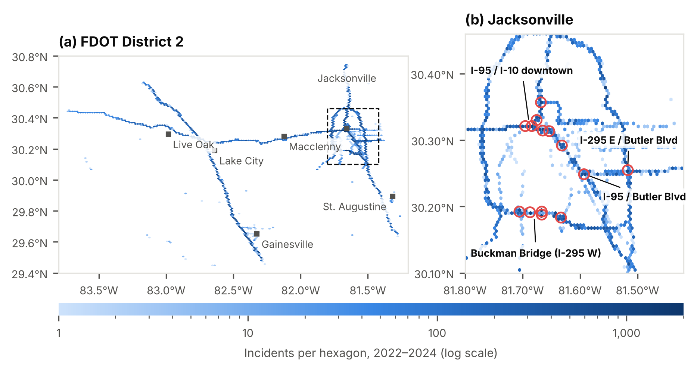

**Figure 1.** Spatial distribution of incidents in FDOT District 2, 2022–2024. (a) District overview; the dashed box marks panel (b). (b) Central Jacksonville; red circles mark 14 of the 15 busiest 1 km grid cells. Hexagon shading shows incident counts on a logarithmic scale.

*Cited in [Section 2.1](#sec-2-1), [Section 3.3](#sec-3-3).*

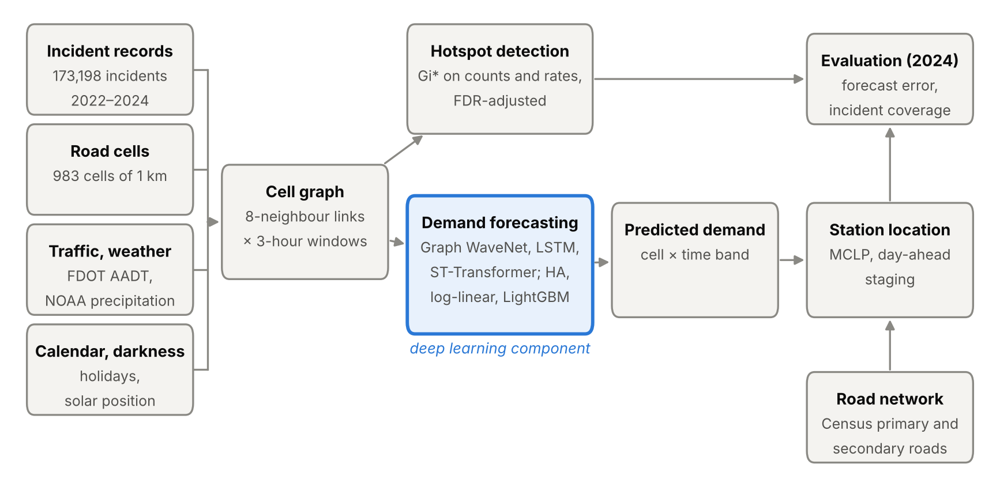

**Figure 2.** Study framework. AADT: annual average daily traffic; NOAA: National Oceanic and Atmospheric Administration; HA: historical average; FDR: false discovery rate; MCLP: maximal covering location problem.

*Cited in [Section 2.4](#sec-2-4).*

**Figure 3.** Mean number of incidents per hour, by hour of day and day of week, 2022–2024.

*Cited in [Section 3.2](#sec-3-2).*

**Figure 4.** The 15 one-kilometre grid cells with the highest mean annual number of incidents, with incidents per year and crash share.

*Cited in [Section 3.3](#sec-3-3).*

**Figure 5.** Event duration (first to last log update) by incident type; boxes show the interquartile range, whiskers the 5th–95th percentiles; logarithmic scale. Events shorter than 1 minute or longer than 24 hours excluded (n = 5,189).

*Cited in [Section 3.4](#sec-3-4).*

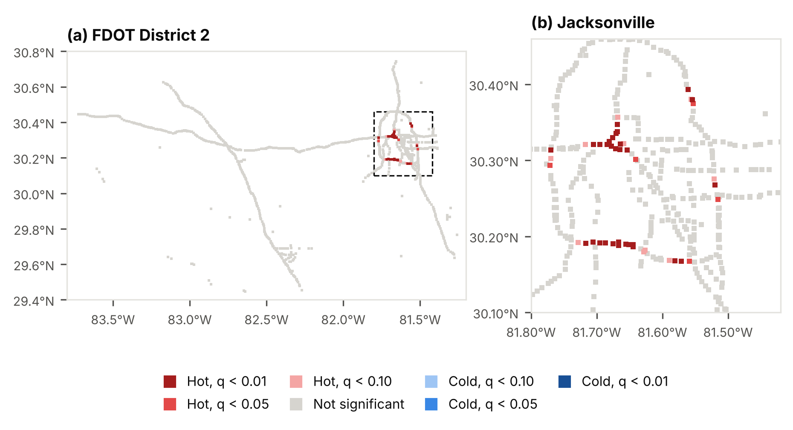

**Figure 6.** Getis-Ord Gi* hotspots of incidents on 1 km road cells, 2022–2024 (binary weights within 2 km; Benjamini–Hochberg q-values). (a) FDOT District 2; (b) Jacksonville, with hotspot cluster IDs H1–H8.

*Cited in [Section 3.7](#sec-3-7).*

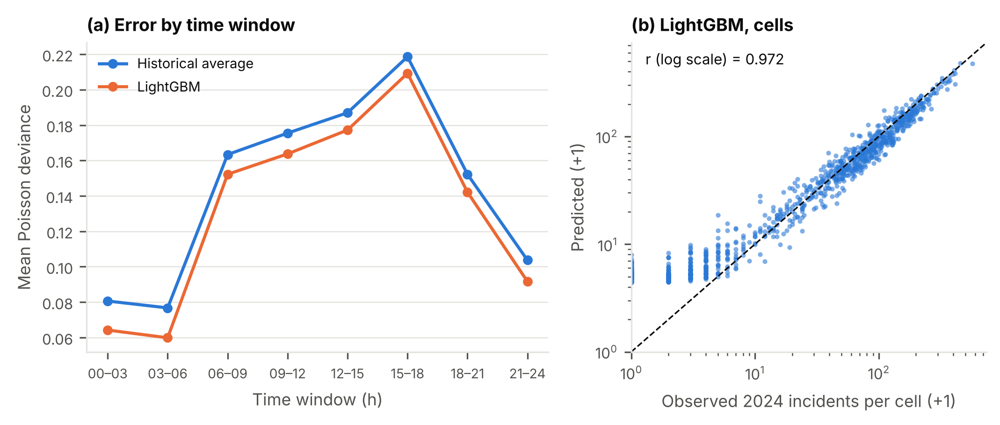

**Figure 7.** Day-ahead forecast performance on 2024. (a) Mean Poisson deviance of each deep model relative to LightGBM, by three-hour window. (b) Observed vs predicted 2024 incidents per cell, Graph WaveNet (log scales; dashed line: equality).

*Cited in [Section 3.8](#sec-3-8).*

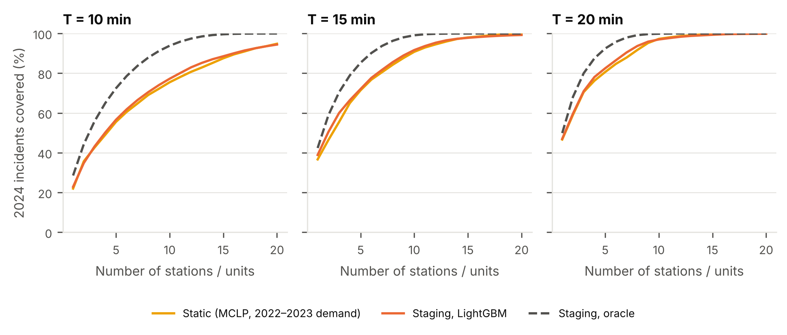

**Figure 8.** Share of 2024 incidents within 10, 15 and 20 minutes of the nearest station or staged unit, by number of stations or units: static layouts (2022–2023 demand), day-ahead staging from five forecasts (line: mean; band: range), and the oracle upper bound.

*Cited in [Section 3.9](#sec-3-9).*

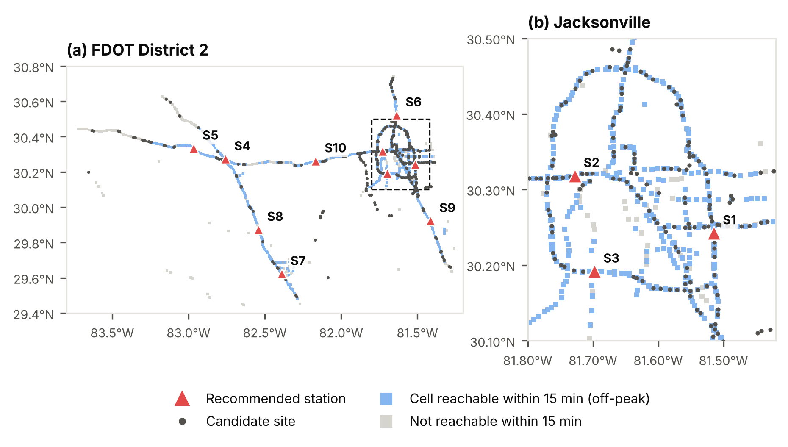

**Figure 9.** Recommended static station locations (10 stations, 15-minute standard), labelled S1–S10, and the 307 candidate sites (interchanges, rest areas and service plazas). Blue cells: at least half of the cell's 2024 incidents within 15 minutes of a station at off-peak speed. (a) FDOT District 2; (b) Jacksonville.

*Cited in [Section 3.9](#sec-3-9).*

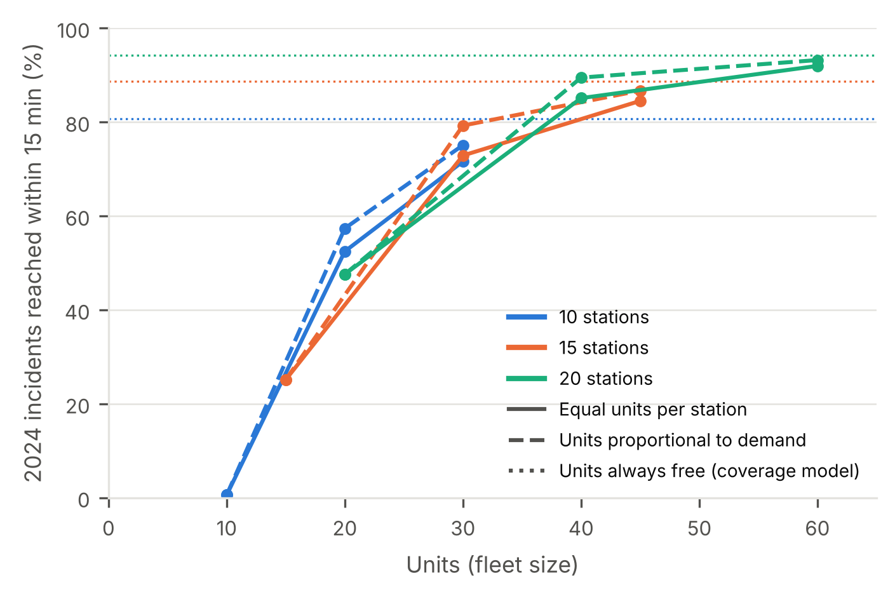

**Figure 10.** Simulated share of 2024 incidents reached within 15 minutes by fleet size, for layouts of 10, 15 and 20 stations, with equal units per station (solid) or units allocated in proportion to 2022–2023 demand (dashed). Dotted lines: coverage when units are always free.

*Cited in [Section 3.11](#sec-3-11).*

## Appendix B. Tables

**Table 1.** Characteristics of incidents by type, FDOT District 2, 2022–2024.

| Incident type | n | % | 2022 | 2023 | 2024 | Median duration, min (IQR) | Weekday % | 15:00–17:59 % | AVL-created % |
| --- | ---: | ---: | ---: | ---: | ---: | --- | ---: | ---: | ---: |
| Disabled vehicle | 101,933 | 58.9 | 33,260 | 32,828 | 35,845 | 13.4 (4.9–31.7) | 75.4 | 23.0 | 67.9 |
| Crash | 44,158 | 25.5 | 14,401 | 15,013 | 14,744 | 56.7 (29.9–88.2) | 77.4 | 25.3 | 4.9 |
| Debris on roadway | 16,979 | 9.8 | 5,822 | 5,529 | 5,628 | 12.8 (3.8–28.6) | 78.0 | 22.1 | 36.3 |
| Abandoned vehicle | 10,128 | 5.8 | 3,284 | 3,080 | 3,764 | 4.7 (3.0–9.9) | 75.0 | 12.5 | 86.8 |
| **All** | **173,198** | **100.0** | **56,767** | **56,450** | **59,981** | **18.9 (5.7–45.6)** | **76.2** | **22.9** | **49.8** |

*Note:* Duration excludes 5,189 flagged events (< 1 min or > 24 h). AVL-created: event created by the `avlrrsubsystem` account. IQR: interquartile range.

**Table 2.** Incident hotspot clusters: contiguous Gi* hot cells (q < 0.05), named after their busiest cell, 2022–2024.

| ID | Hotspot location | Routes | Size (1 km cells) | Incidents per year | Crash share (%) | Cells hot in all 3 years | Max Gi* z | Million vehicle-km per year | Incidents per million vehicle-km |
| --- | --- | --- | ---: | ---: | ---: | ---: | ---: | ---: | ---: |
| H1 | I-95 at ramp to I-10 (Duval County) | Acosta Bridge, I-10, I-95 | 14 | 3,290 | 40.8 | 13 of 14 | 7.77 | 787.8 | 4.18 |
| H2 | I-295 W at Buckman Bridge (Duval County) | I-295 W | 11 | 2,382 | 17.1 | 11 of 11 | 6.96 | 422.4 | 5.64 |
| H3 | I-295 W at I-95S/I-295 E (Duval County, MM 1) | I-295 W | 3 | 554 | 23.6 | 2 of 3 | 4.25 | 216.9 | 2.56 |
| H4 | I-295 E at Dames Point Bridge (Duval County) | I-295 E | 3 | 409 | 17.2 | 2 of 3 | 3.69 | 69.1 | 5.92 |
| H5 | I-295 W at ramp to Normandy Blvd/SR-228 (Duval County, MM 18) | I-295 W | 1 | 287 | 32.6 | 0 of 1 | 3.37 | 56.5 | 5.08 |
| H6 | I-295 W at I-10 (Duval County, MM 20) | I-295 W | 1 | 256 | 38.3 | 1 of 1 | 3.76 | 98.7 | 2.59 |
| H7 | I-295 E at St Johns Bluff Rd/UNF (Duval County) | I-295 E | 1 | 203 | 55.3 | 1 of 1 | 4.15 | 65.4 | 3.10 |
| H8 | I-295 E at ramp to Butler Blvd EB ramp (Duval County, MM 54) | I-295 E | 1 | 185 | 37.0 | 1 of 1 | 3.26 | 133.5 | 1.38 |

*Note:* Incidents per year and vehicle-km are summed over the cluster's cells. Vehicle-km: FDOT AADT × segment length within the cell × days, on FDOT roadways with at least 20 matched incidents, mean of 2022–2024.

**Table 3.** Day-ahead forecast performance on 2024 (366 days × 8 windows × 983 cells); mean ± s.d. over five seeds where applicable.

| Model | Runs | MAE (×10⁻²) | RMSE (×10⁻²) | Poisson deviance (×10⁻²) | Hit rate, top 5% cells (%) | PAI |
| --- | ---: | --- | --- | --- | --- | --- |
| Historical average | 1 | 3.796 | 15.068 | 14.471 | 23.26 | 4.57 |
| Poisson log-linear | 1 | 3.781 | 15.054 | 13.259 | 22.85 | 4.49 |
| LightGBM | 5 | 3.801 ± 0.002 | 15.044 ± 0.001 | 13.266 ± 0.006 | 23.59 ± 0.04 | 4.64 ± 0.01 |
| LSTM (no graph) | 5 | 3.832 ± 0.029 | 15.054 ± 0.005 | 13.329 ± 0.018 | 23.48 ± 0.12 | 4.62 ± 0.02 |
| Graph WaveNet | 5 | 3.838 ± 0.020 | 15.054 ± 0.005 | 13.327 ± 0.022 | 23.49 ± 0.10 | 4.62 ± 0.02 |
| ST-Transformer | 5 | 3.866 ± 0.052 | 15.058 ± 0.005 | 13.343 ± 0.017 | 23.37 ± 0.12 | 4.59 ± 0.02 |

*Note:* PAI: predictive accuracy index.

**Table 4.** Station layouts with 10 stations or units, evaluated on the 59,981 incidents of 2024.

| Layout (demand source) | Stations | Covered ≤ 10 min (%) | ≤ 15 min (%) | ≤ 20 min (%) | Mean travel time (min) |
| --- | ---: | ---: | ---: | ---: | ---: |
| Current Road Ranger stations | 10 | [pending] | [pending] | [pending] | [pending] |
| Sites nearest the busiest cells (no optimisation) | 10 | 37.9 | 47.1 | 52.2 | 40.5 |
| Random candidate sites (mean of 200 draws) | 10 | 34.8 | 52.7 | 63.8 | 22.5 |
| Static stations, 2022–2023 demand (MCLP) | 10 | 62.9 | 80.7 | 91.4 | 11.7 |
| Day-ahead staging, historical average | 10 | 63.5 | 80.5 | 90.4 | 12.4 |
| Day-ahead staging, LightGBM | 10 | 63.2 | 80.6 | 90.3 | 12.3 |
| Day-ahead staging, LSTM | 10 | 63.5 | 80.5 | 90.4 | 12.4 |
| Day-ahead staging, Graph WaveNet | 10 | 63.5 | 80.5 | 90.4 | 12.3 |
| Day-ahead staging, ST-Transformer | 10 | 63.5 | 80.5 | 90.4 | 12.4 |
| Day-ahead staging, oracle (upper bound) | 10 | 79.9 | 91.3 | 95.5 | 10.1 |

*Note:* Comparison layouts are not optimised: the candidate site nearest each of the busiest 2022–2023 cells (distinct sites), and random candidate sites (mean of 200 draws). Static layouts are solved separately for each response-time standard; their mean travel time refers to the 15-minute layout. Travel times: shortest paths on the directed OpenStreetMap network (motorway, trunk and primary roads with ramps), with incidents matched to their recorded direction of travel.

**Table 5.** Recommended station sites (10 stations, 15-minute standard, 2022–2023 demand), selected from 307 candidate interchanges, rest areas and service plazas.

| ID | Station site | Nearest incident landmark | Latitude | Longitude | 2024 incidents nearest to station | Share of 2024 incidents (%) | Of these, reached within 15 min (%) |
| --- | --- | --- | ---: | ---: | ---: | ---: | ---: |
| S1 | I-295 Exit 54, Duval County | I-295 E at Gate Parkway | 30.2425 | -81.5146 | 10,274 | 17.1 | 89.2 |
| S2 | I-10 Exit 358, Duval County | I-10 at Cassat Ave | 30.3182 | -81.7278 | 9,580 | 16.0 | 92.2 |
| S3 | I-295 Exit 10, Duval County | I-295 W between Buckman Bridge and US-17 | 30.1918 | -81.6975 | 6,849 | 11.4 | 97.7 |
| S4 | I-75 Exit 435, Columbia County | I-75 at ramp to I-10 | 30.2733 | -82.7582 | 6,411 | 10.7 | 77.5 |
| S5 | I-10 Exit 283, Suwannee County | I-10 at US-129 | 30.3332 | -82.9664 | 5,757 | 9.6 | 32.3 |
| S6 | I-95 Exit 366, Duval County | I-95 at ramp from Pecan Park Rd | 30.5222 | -81.6357 | 5,478 | 9.1 | 86.2 |
| S7 | I-75 Exit 384, Alachua County | I-75 at ramp from SR-24/Archer Rd | 29.6220 | -82.3895 | 5,038 | 8.4 | 77.3 |
| S8 | I-75 Exit 404, Alachua County | I-75 at ramp to CR-236 | 29.8729 | -82.5424 | 4,223 | 7.0 | 85.5 |
| S9 | I-95 Exit 318, St. Johns County | I-95 at SR-16 | 29.9221 | -81.4139 | 3,384 | 5.6 | 77.7 |
| S10 | I-10 Exit 333, Baker County | I-10 at CR-125 | 30.2615 | -82.1657 | 2,987 | 5.0 | 68.9 |

*Note:* Coordinates are OpenStreetMap site locations (WGS84). Nearest incident landmark: name of the closest 1 km road cell, from the incident location descriptions.

**Table 6.** Discrete-event simulation of 2024 with busy units: response to the 59,981 incidents of 2024 by layout, fleet size and unit allocation.

| Case | Stations | Units | Unit allocation | Reached ≤ 10 min (%) | ≤ 15 min (%) | ≤ 20 min (%) | ≤ 15 min, units always free (%) | Mean response (min) | 90th percentile (min) | Delayed by busy units (%) | Utilisation (%) |
| --- | ---: | ---: | --- | ---: | ---: | ---: | ---: | ---: | ---: | ---: | ---: |
| Base | 10 | 10 | Equal | 0.4 | 0.6 | 0.7 | 80.7 | overloaded | overloaded | 99.4 | 108.0 |
| Base | 10 | 20 | Equal | 34.8 | 52.4 | 63.3 | 80.7 | 27.0 | 59.8 | 43.0 | 39.2 |
| Base | 10 | 20 | Proportional | 38.8 | 57.4 | 67.7 | 80.7 | 24.9 | 54.2 | 37.4 | 38.2 |
| Base | 10 | 30 | Equal | 49.0 | 71.6 | 82.3 | 80.7 | 14.3 | 30.6 | 16.8 | 23.8 |
| Base | 10 | 30 | Proportional | 52.2 | 75.1 | 85.0 | 80.7 | 13.6 | 26.3 | 11.3 | 23.5 |
| Base | 15 | 15 | Equal | 16.2 | 25.1 | 31.5 | 88.7 | 91.5 | 232.4 | 78.0 | 62.5 |
| Base | 15 | 30 | Equal | 51.3 | 72.9 | 83.1 | 88.7 | 13.5 | 26.6 | 26.7 | 23.0 |
| Base | 15 | 30 | Proportional | 57.7 | 79.2 | 88.4 | 88.7 | 11.6 | 21.4 | 17.2 | 22.4 |
| Base | 15 | 45 | Equal | 61.9 | 84.5 | 93.0 | 88.7 | 9.9 | 17.5 | 9.0 | 14.5 |
| Base | 15 | 45 | Proportional | 64.7 | 86.7 | 94.3 | 88.7 | 9.5 | 16.4 | 4.2 | 14.4 |
| Base | 20 | 20 | Equal | 33.3 | 47.6 | 56.7 | 94.2 | 34.9 | 88.3 | 61.9 | 40.8 |
| Base | 20 | 40 | Equal | 66.5 | 85.1 | 92.3 | 94.2 | 9.5 | 17.9 | 18.5 | 16.1 |
| Base | 20 | 40 | Proportional | 71.8 | 89.5 | 95.1 | 94.2 | 8.6 | 15.3 | 10.1 | 15.8 |
| Base | 20 | 60 | Equal | 74.4 | 92.0 | 96.9 | 94.2 | 7.9 | 14.2 | 5.9 | 10.4 |
| Base | 20 | 60 | Proportional | 76.4 | 93.2 | 97.1 | 94.2 | 7.8 | 13.5 | 2.1 | 10.4 |
| On-scene time halved | 10 | 20 | Proportional | 47.3 | 68.6 | 79.1 | 80.7 | 15.7 | 34.8 | 22.7 | 26.5 |
| AVL-created incidents excluded | 10 | 20 | Proportional | 48.4 | 69.8 | 79.7 | 84.4 | 17.0 | 34.9 | 22.5 | 23.1 |

*Note:* Each incident is assigned to the unit that can reach it first; a unit is busy for travel, on-scene time (logged event duration; type median where flagged) and return to its station. Utilisation above 100%: demand exceeds capacity and the queue grows through the year. Sensitivity rows: 10 stations, 20 units, proportional allocation.

*Cited in [Section 3.11](#sec-3-11).*

## Appendix C. Supplementary material

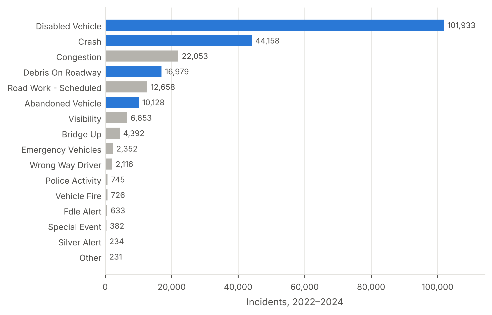

**Figure S1.** Frequency of all recorded event types, 2022–2024; blue bars mark the four incident types analysed.

*Cited in [Section 3.1](#sec-3-1).*

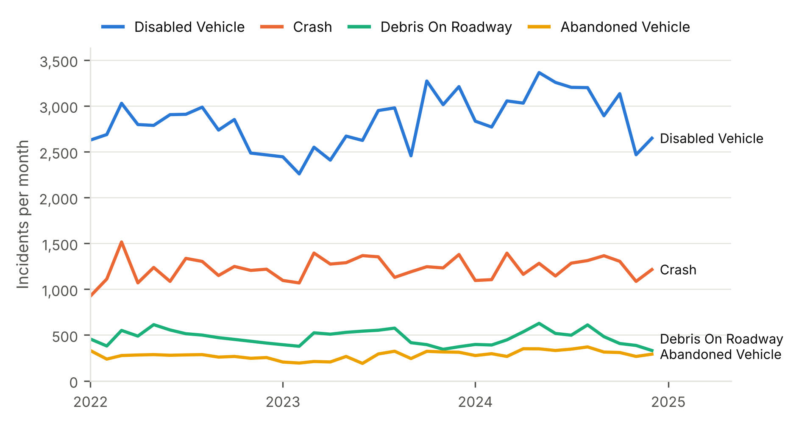

**Figure S2.** Monthly number of incidents by type, January 2022 – December 2024.

*Cited in [Section 3.1](#sec-3-1).*

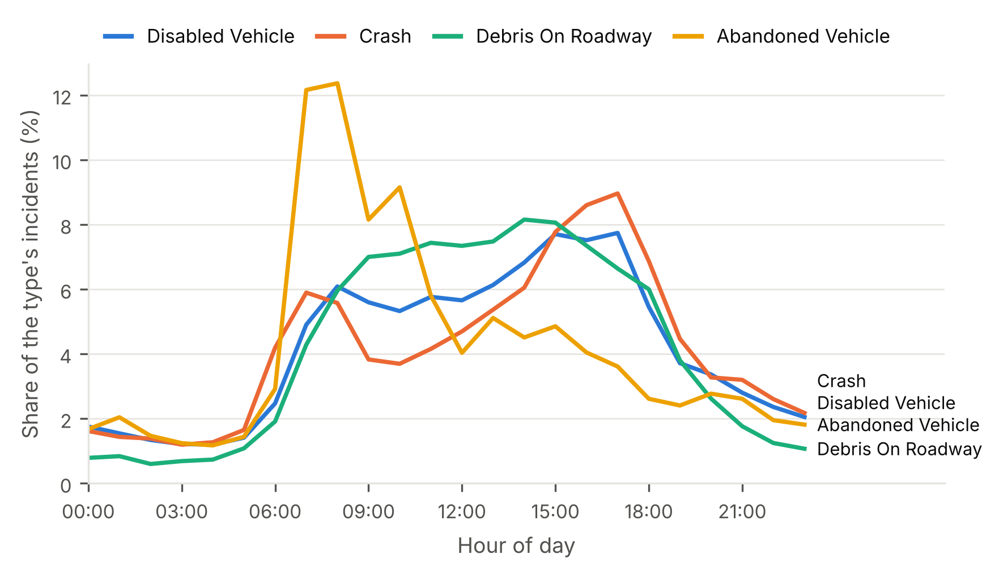

**Figure S3.** Hourly distribution of incidents within each type (% of the type's total).

*Cited in [Section 3.2](#sec-3-2).*

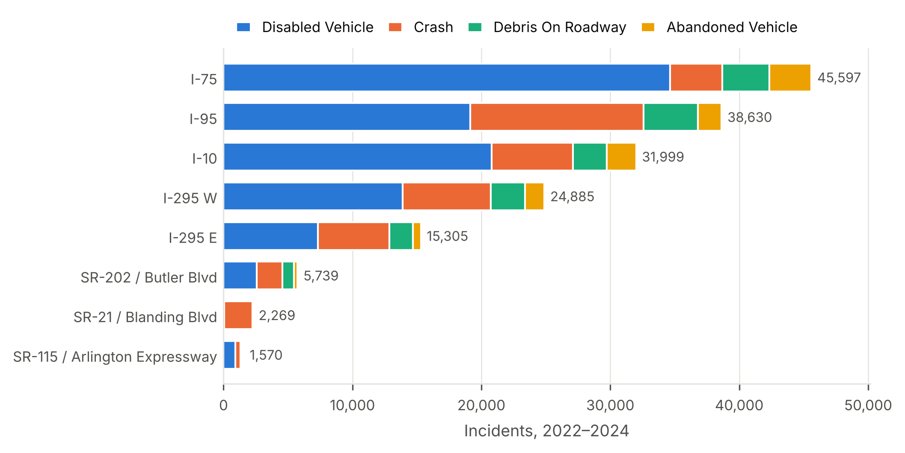

**Figure S4.** Incidents by route and type for the eight routes with the most incidents, 2022–2024.

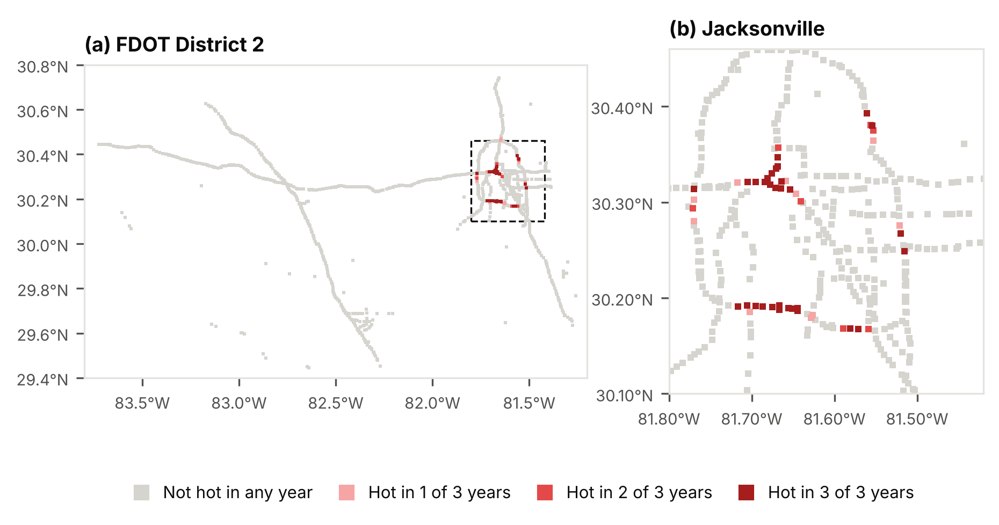

**Figure S5.** Number of years (2022, 2023, 2024) in which each cell was a Gi* hot spot (q < 0.05).

*Cited in [Section 3.7](#sec-3-7).*

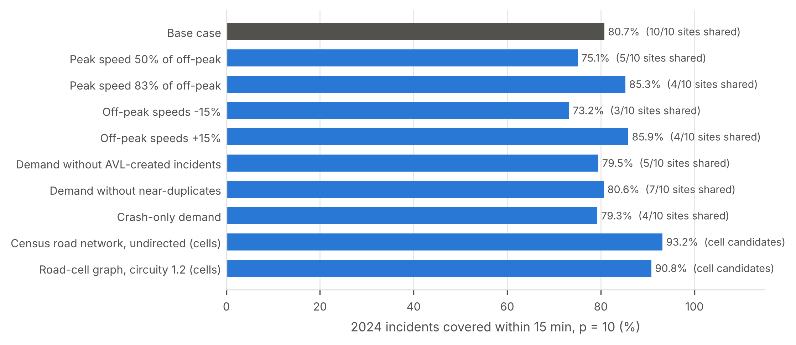

**Figure S6.** Sensitivity of the static layout (10 stations, 15-minute standard): coverage within 15 minutes and base-case stations retained under alternative speeds, demand definitions and travel-time models; the two cell-based travel-time models use road cells as candidate sites, so shared stations are not reported for them.

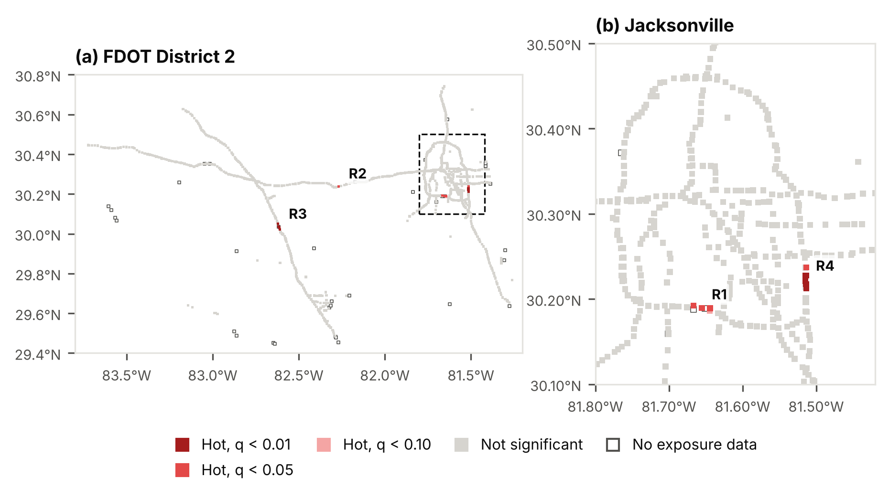

**Figure S7.** Getis-Ord Gi* hotspots of incident rates per million vehicle-km (empirical Bayes-smoothed), 2022–2024 (binary weights within 2 km; Benjamini–Hochberg q-values). Open squares: cells without matched AADT segments. (a) FDOT District 2; (b) Jacksonville; cluster IDs R1–R4.

*Cited in [Section 3.7](#sec-3-7).*

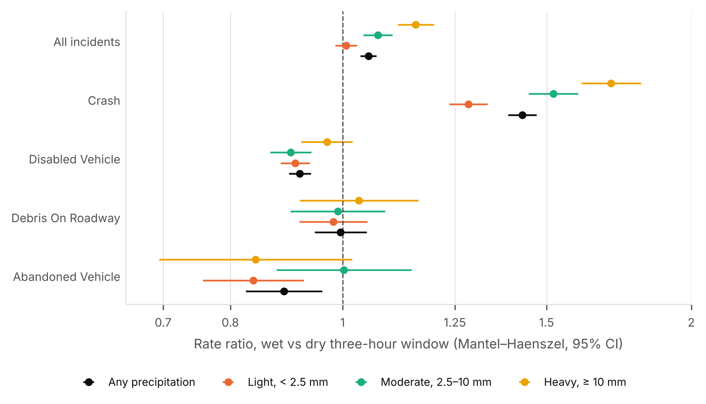

**Figure S8.** Incident rate ratios for three-hour windows with vs without precipitation at the nearest NOAA station, by incident type and precipitation total in the window. Mantel–Haenszel estimates stratified by window of day, month and day type, with 95% confidence intervals; logarithmic scale.

*Cited in [Section 3.6](#sec-3-6).*

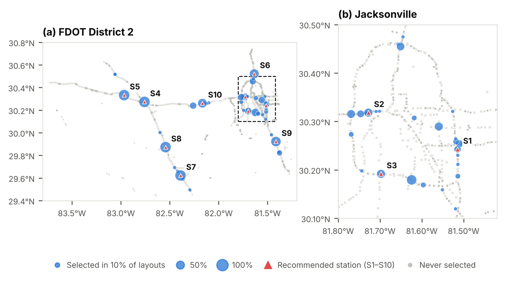

**Figure S9.** Share of re-solved layouts (10 stations, 15-minute standard) that select each candidate site: 200 bootstrap resamples of 2022–2023 days, 2022 and 2023 alone, and seven speed and demand scenarios. Triangles: recommended stations S1–S10. (a) FDOT District 2; (b) Jacksonville.

*Cited in [Section 3.10](#sec-3-10).*

**Table S1.** Completeness and variability of candidate explanatory variables (incidents, n = 173,198).

| Indicator | Share of incidents (%) |
| --- | ---: |
| Severity recorded as "minor" | 99.9 |
| Road surface "Dry" | 98.8 |
| Weather "Clear" | 98.3 |
| Weather "Clear" in three-hour windows with NOAA-recorded precipitation (n = 17,323) | 94.9 |
| Lighting code 16 (code meaning undocumented) | 91.7 |
| Mile marker missing | 53.0 |
| Created by the `avlrrsubsystem` account | 49.8 |
| Duration > 24 h (flagged) | 2.3 |
| Duration < 1 min (flagged) | 0.7 |
| Dark at time of incident (solar elevation below −6°) | 21.7 |
| Near-duplicate (same route and direction, ≤ 0.5 km, ≤ 15 min) | 1.8 |

**Table S2.** Rate hotspot clusters: contiguous Gi* hot cells (q < 0.05) on incidents per million vehicle-km, named after their busiest cell, 2022–2024.

| ID | Hotspot location | Routes | Size (1 km cells) | Incidents per year | Million vehicle-km per year | Incidents per million vehicle-km | Crash share (%) | Max Gi* z | Overlaps a count hotspot (Table 2) |
| --- | --- | --- | ---: | ---: | ---: | ---: | ---: | ---: | --- |
| R1 | I-295 W at Buckman Bridge (Duval County) | I-295 W | 3 | 649 | 103.4 | 6.28 | 10.4 | 3.81 | Yes |
| R2 | I-10 at ramp from CR-229 (Baker County, MM 326) | I-10 | 1 | 59 | 10.0 | 5.94 | 10.1 | 3.62 | No |
| R3 | I-75 (Columbia County, MM 417) | I-75 | 5 | 511 | 89.1 | 5.73 | 7.6 | 10.45 | No |
| R4 | I-295 E at Baymeadows Rd (Duval County, MM 57) | 295 East Express, I-295 E | 6 | 356 | 170.1 | 2.09 | 27.1 | 5.35 | No |

*Note:* Rates are cluster totals (incidents ÷ vehicle-km). Gi* used empirical Bayes-smoothed cell rates for the 944 cells with exposure data.

*Cited in [Section 3.7](#sec-3-7).*

**Table S3.** LightGBM input ablation, day-ahead forecasts for 2024; mean ± s.d. over five seeds.

| LightGBM inputs | Runs | Poisson deviance (×10⁻²) | Hit rate, top 5% cells (%) | PAI | Deviance difference vs day-ahead model (×10⁻², 95% CI) |
| --- | ---: | --- | ---: | ---: | --- |
| Base inputs only (no AADT, no precipitation) | 5 | 13.256 ± 0.011 | 23.59 | 4.64 | -0.011 (-0.012 to -0.009) |
| Base inputs + AADT exposure | 5 | 13.264 ± 0.013 | 23.58 | 4.64 | -0.002 (-0.003 to -0.001) |
| Base inputs + AADT exposure + previous-day precipitation (day-ahead model) | 5 | 13.266 ± 0.006 | 23.59 | 4.64 | — |
| As above + observed precipitation in the target window (perfect-forecast bound) | 5 | 13.253 ± 0.007 | 23.63 | 4.65 | -0.014 (-0.016 to -0.012) |

*Note:* Differences: day-level bootstrap (2,000 resamples) of mean daily deviance, seed-averaged predictions.

*Cited in [Section 3.8](#sec-3-8).*

**Table S4.** Temporal validation of the static layout (10 stations, 15-minute standard): sites selected on one period and evaluated on the following year.

| Sites selected on | Evaluated on | Covered ≤ 15 min (%) | Layout optimised on the evaluation year (%) | Sites shared with that layout | Sites shared with the recommended layout |
| --- | --- | ---: | ---: | ---: | ---: |
| 2022 | 2023 | 81.4 | 81.3 | 5 of 10 | 10 of 10 |
| 2023 | 2024 | 80.5 | 80.6 | 6 of 10 | 5 of 10 |
| 2022–2023 | 2024 | 80.7 | 80.6 | 7 of 10 | 10 of 10 |

*Note:* The layout optimised on the evaluation year uses that year's incidents and is shown for reference.

*Cited in [Section 3.10](#sec-3-10).*

**Table S5.** Robustness of the recommended station sites: share of re-solved layouts that select the site, or any candidate site within 5 km of it.

| ID | Station site | Selected, demand resamples (%) | Site within 5 km selected, demand resamples (%) | Selected, all re-solved layouts (%) | Site within 5 km selected, all layouts (%) |
| --- | --- | ---: | ---: | ---: | ---: |
| S1 | I-295 Exit 54, Duval County | 20.5 | 58.5 | 20.1 | 59.3 |
| S2 | I-10 Exit 358, Duval County | 34.0 | 91.5 | 33.5 | 91.9 |
| S3 | I-295 Exit 10, Duval County | 33.0 | 33.0 | 33.5 | 34.0 |
| S4 | I-75 Exit 435, Columbia County | 100.0 | 100.0 | 100.0 | 100.0 |
| S5 | I-10 Exit 283, Suwannee County | 100.0 | 100.0 | 99.0 | 99.0 |
| S6 | I-95 Exit 366, Duval County | 71.0 | 71.0 | 70.3 | 70.3 |
| S7 | I-75 Exit 384, Alachua County | 100.0 | 100.0 | 97.6 | 99.0 |
| S8 | I-75 Exit 404, Alachua County | 100.0 | 100.0 | 99.5 | 99.5 |
| S9 | I-95 Exit 318, St. Johns County | 82.5 | 82.5 | 80.9 | 81.3 |
| S10 | I-10 Exit 333, Baker County | 67.5 | 68.5 | 66.0 | 67.9 |

*Note:* Demand resamples: 200 bootstrap samples of 2022–2023 days. All re-solved layouts: the 200 resamples, 2022 and 2023 alone, four speed scenarios and three demand definitions (209 layouts).

*Cited in [Section 3.10](#sec-3-10).*

**Table S6.** Coverage of 2024 incidents within 15 minutes under alternative travel speeds: the recommended layout compared with the layout optimised for each speed scenario.

| Travel-speed scenario | Recommended layout, covered ≤ 15 min (%) | Layout optimised for the scenario (%) | Difference (percentage points) | Sites shared |
| --- | ---: | ---: | ---: | ---: |
| Base case | 80.7 | 80.7 | 0.0 | 10 of 10 |
| Peak speed 50% of off-peak | 74.5 | 75.1 | 0.5 | 5 of 10 |
| Peak speed 83% of off-peak | 84.8 | 85.3 | 0.4 | 4 of 10 |
| Off-peak speeds −15% | 72.7 | 73.2 | 0.6 | 3 of 10 |
| Off-peak speeds +15% | 86.5 | 85.9 | -0.6 | 4 of 10 |

*Note:* Layouts are optimised on road-edge midpoints and evaluated at exact incident locations, so a scenario-optimised layout can score slightly below the recommended layout (negative difference).

*Cited in [Section 3.10](#sec-3-10).*
