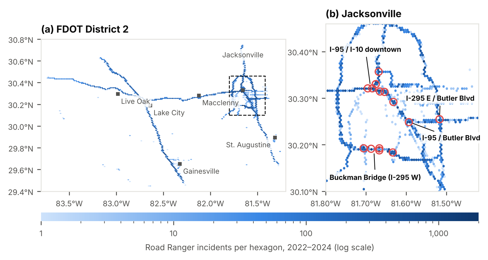
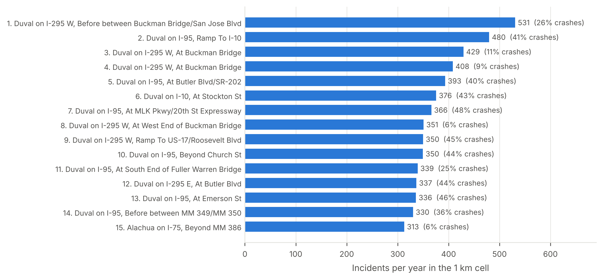
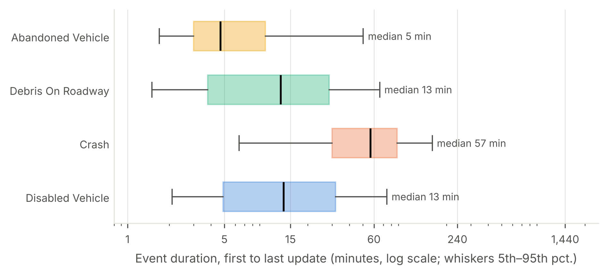
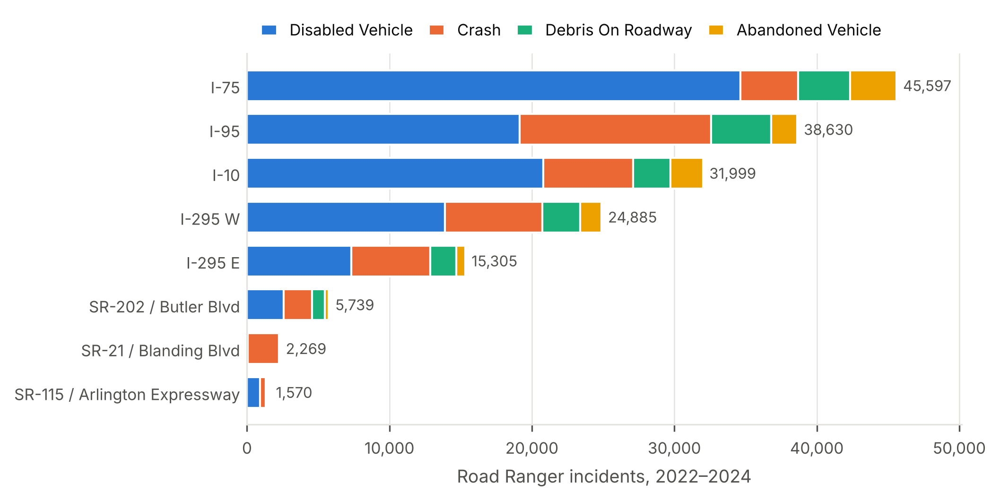

# Manuscript draft

**Locating Road Ranger service patrol stations from incident hotspots: a spatial optimisation study of FDOT District 2, Northeast Florida**

Pascal Antwi¹, [Co-author] Sando²
¹ [Affiliation] · ² [Affiliation] · Corresponding author: [name, email]

*Outline draft, 21 October 2026. Sections are outlined as bullet points to be written up. [Section 5 (Exploratory data analysis)](#sec-5) is drafted in full. The modelling results ([Section 6](#sec-6)) will follow. All figures and tables are in the appendices: [Appendix A](#appendix-a-figures) (figures), [Appendix B](#appendix-b-tables) (tables), [Appendix C](#appendix-c-supplementary-material) (supplementary).*

---

## Abstract (outline, about 250 words; write last)

- **Background:** freeway service patrols cut clearance time and secondary crashes, but station locations are rarely derived from incident data.
- **Objective:** identify where Road Ranger incidents concentrate in FDOT District 2 and choose station locations that maximise timely coverage.
- **Data:** 9.2 million chronology records (2022–2024) reconstructed into 227,196 events; 173,198 Road Ranger incidents.
- **Methods:** exploratory analysis; network kernel density and Gi* hotspots; maximal covering and p-median location models; hold-out validation.
- **Key EDA findings:** 90.3% of incidents on five corridors; half of incidents in 14.8% of occupied 1 km cells; weekday 15:00–17:59 peak; crash events open about four times longer than other types.
- **Modelling results:** [pending] number and location of stations; coverage gain over the current layout.
- **Implication:** an evidence base for station siting, plus a warning about detection bias in patrol-generated records.
- **Keywords:** freeway service patrol; Road Rangers; traffic incident management; hotspot analysis; maximal covering location problem; Florida.

## 1. Introduction (outline)

1. **Problem.** Incidents cause non-recurrent congestion; each minute on the roadway raises secondary-crash risk [REF].
2. **Service patrols.** What Road Rangers do; evidence of their benefits [REF: FDOT Road Ranger evaluations; FHWA TIM].
3. **Gap.** Station and staging locations follow practice, not systematic incident analysis; hotspot studies stop at the map.
4. **Aim and objectives.** (i) Characterise when and where incidents occur; (ii) identify significant network hotspots; (iii) optimise station locations and compare them with the current layout.
5. **Contribution.** A reproducible workflow from raw chronology logs to an optimised station plan, plus an assessment of detection bias.
6. **Paper structure.** One sentence per section.

## 2. Literature review (outline, 40–60 references)

### 2.1 Freeway service patrols
- Effects on detection, response and clearance time; secondary crashes.
- Benefit–cost evaluations of Road Rangers and comparable programmes [REF].

### 2.2 Incident and crash hotspot detection
- Planar vs network kernel density estimation (Xie and Yan, 2008; Okabe et al., 2009).
- Local spatial statistics: Getis-Ord Gi* (Getis and Ord, 1992; Ord and Getis, 1995).
- Count vs exposure-based (AADT) hotspots.

### 2.3 Facility location for emergency response
- Set covering (Toregas et al., 1971), maximal covering (Church and ReVelle, 1974), p-median (Hakimi, 1964).
- Response-time standards; backup coverage.

### 2.4 Patrol beat and fleet design
- Beat length, fleet size, time-of-day deployment [REF].

### 2.5 Research gap
- One paragraph: no study links network-constrained incident hotspots to optimised service-patrol station locations with validation.

## 3. Data (outline)

### 3.1 Study area 
- FDOT District 2: 15 counties of Northeast Florida; Jacksonville, Gainesville, Lake City; I-75, I-95, I-10 and the I-295 beltway.
- [Figure 1](#figure-1) shows the area and the incident distribution.

### 3.2 Incident data 
- Source: regional traffic management system event chronology export, 1 Jan 2022 – 31 Dec 2024 [REF: data owner, permission].
- Structure: one record per update to an event; key fields (event ID, timestamp, type, roadway, coordinates, conditions).
- Processing summary: [Table 1](#table-1).

### 3.3 Supplementary data
- Road network: OpenStreetMap (Boeing, 2017).
- Traffic volume: FDOT AADT.
- Boundaries: US Census TIGER/Line.
- Current Road Ranger stations and beats: FDOT District 2 [pending].

## 4. Methodology (outline)

### 4.1 Data processing
- Chunked cleaning; duplicates and repeated chronology IDs removed.
- Timestamps parsed in UTC, converted to US Eastern time.
- Coordinates rescaled from micro-degrees; points outside Florida removed.
- One row per event: type and conditions from the first record, location from the latest.
- Roadway text parsed into county, route, direction, mile marker.
- Duration = first to last log update; values < 1 min or > 24 h flagged.
- Analysis sample: disabled vehicle, crash, debris, abandoned vehicle ([Table 1](#table-1)).

### 4.2 Exploratory data analysis
- Temporal aggregation by month, weekday and hour.
- Spatial concentration on a 1 km grid: incidents per year, crash share, modal location per cell.
- Hexagonal density mapping (log scale).
- Data-quality screening of candidate covariates.
- Results: [Section 5](#sec-5).

### 4.3 Network hotspot detection [modelling, to do]
- Snap incidents to the network; 0.5-mile segments.
- Network KDE (Okabe et al., 2009); Gi* with FDR correction (Benjamini and Hochberg, 1995).
- Counts and AADT-based rates; year-by-year persistence.

### 4.4 Station location models [modelling, to do] 
- Maximal covering location problem (Church and ReVelle, 1974):

$$
\max \sum_{i \in I} a_i y_i \quad \text{s.t.} \quad \sum_{j \in N_i} x_j \ge y_i \;\; \forall i, \qquad \sum_{j \in J} x_j = p, \qquad x_j, y_i \in \{0, 1\},
$$

  where *aᵢ* is the demand on segment *i*, *Nᵢ* the candidate sites within response time *T* of *i*, and *p* the number of stations.
- p-median companion model (Hakimi, 1964); the current layout as the baseline.

### 4.5 Validation and sensitivity [modelling, to do] 
- Fit on 2022–2023, test on 2024.
- Vary segment length, bandwidth, *T* (10/15/20 min), demand weights (count, crash, duration) and exclusion of AVL-detected incidents.

## 5. Exploratory data analysis 

### 5.1 Sample characteristics 

Between 1 January 2022 and 31 December 2024, 227,196 unique events were recorded in FDOT District 2, reconstructed from 9,206,764 chronology records ([Table 1](#table-1)). The four Road Ranger service types made up 173,198 events (76.2%) and form the analysis sample. The remaining events were traffic-management notices, chiefly congestion (22,053), scheduled road work (12,658) and bridge openings (4,392) ([Figure S1](#figure-s1)). Disabled vehicles were the most frequent incident type (58.9%), followed by crashes (25.5%), debris (9.8%) and abandoned vehicles (5.8%) ([Table 2](#table-2)). Annual totals varied by less than 7% (56,450 to 59,981), with no sustained trend in any type ([Figure S2](#figure-s2)).

**Interpretation.** Patrol demand is dominated by non-crash assistance: disabled vehicles outnumber crashes by more than two to one ([Table 2](#table-2)), so planning from crash data alone would miss most of the workload. The stability shown in [Figure S2](#figure-s2) supports pooling 2022–2024 as the demand input for the location models ([Section 4.4](#sec-4-4)).

### 5.2 Temporal patterns 

Weekdays accounted for 76.2% of incidents, and the mean daily count was 28% higher on weekdays than at weekends (168.7 vs 131.5) ([Table 2](#table-2)). Incidents peaked between 15:00 and 17:59 on weekdays, with a maximum on Fridays from 15:00 to 15:59 (14.7 per hour), against about two per hour between 01:00 and 04:59 ([Figure 2](#figure-2)). Crashes had a morning peak at 07:00 (5.9%) and a larger evening peak at 17:00 (9.0%). Debris showed a midday plateau (09:00–16:00), and abandoned vehicles clustered at 07:00–08:59 (24.6%) ([Figure S3](#figure-s3)).

**Interpretation.** The afternoon peak in [Figure 2](#figure-2) coincides with commuter traffic, consistent with exposure rather than time of day driving occurrence. The roughly sevenfold gap between overnight and peak demand argues for evaluating coverage separately for peak and off-peak periods. The morning spike in abandoned vehicles ([Figure S3](#figure-s3)) most plausibly reflects detection on first patrols rather than when vehicles were abandoned.

### 5.3 Spatial distribution and concentration 

Incidents were confined to the limited-access network and concentrated around Jacksonville ([Figure 1](#figure-1)a). Duval County accounted for 53.2% of incidents ([Table S3](#table-s3)). Five routes, I-75 (26.3%), I-95 (22.3%), I-10 (18.5%), I-295 W (14.4%) and I-295 E (8.8%), carried 90.3% ([Figure S4](#figure-s4)). Crashes made up 34.8% of incidents on I-95 but 8.9% on I-75, where disabled vehicles accounted for 76.0%. Of the 983 occupied 1 km cells, 145 (14.8%) contained half of all incidents. The 15 busiest contained 9.9% ([Figure 3](#figure-3)) and the 50 busiest 24.2% ([Table S2](#table-s2)). Fourteen of the top 15 cells lie in central Jacksonville in four clusters: the Buckman Bridge (I-295 W), the I-95/I-10 interchange, I-95 at Butler Boulevard and I-295 E at Butler Boulevard ([Figure 1](#figure-1)b). Interchange cells had crash shares of 40–48%, whereas bridge and rural cells (the Buckman Bridge and I-75 near Gainesville) had 6–11% ([Figure 3](#figure-3)).

**Interpretation.** The concentration in [Figure 3](#figure-3) and [Table S2](#table-s2) is the precondition for coverage-based siting: a few stations can reach a large share of demand. The contiguous clusters in [Figure 1](#figure-1)b suggest that each cluster is one candidate service zone. Crash-dominated interchange hotspots call for rapid clearance; bridge and rural hotspots call for fast vehicle removal. These planar results are descriptive; network significance and AADT normalisation follow in the modelling ([Section 6](#sec-6)).

### 5.4 Event duration 

The median event duration was 18.9 minutes (IQR 5.7–45.6) ([Table 2](#table-2)). Crash events remained open for a median of 56.7 minutes, about four times longer than disabled vehicles (13.4) and debris (12.8). Abandoned vehicles were shortest at 4.7 minutes ([Figure 4](#figure-4)). The 5,189 flagged events (3.0%) were excluded ([Table 1](#table-1)).

**Interpretation.** Crash events tie up units about four times longer ([Figure 4](#figure-4)), so crash-dominated hotspots consume more capacity than their counts imply. This motivates a duration-weighted demand scenario ([Section 4.5](#sec-4-5)). Duration is a log-based proxy for how long an event stayed open, not on-scene clearance time.

### 5.5 Data quality and detection 

Half of all incidents (49.8%) were created by the Road Ranger AVL subsystem ([Table S1](#table-s1)), from 4.9% of crashes to 86.8% of abandoned vehicles ([Table 2](#table-2)), and from 35% on I-95 to 73% on I-75. Severity was recorded as minor for 99.9% of incidents, pavement as dry for 98.8% and weather as clear for 98.3%. Mile markers were missing for 53.0% ([Table S1](#table-s1)).

**Interpretation.** The AVL shares in [Table 2](#table-2) indicate that many non-crash incidents are discovered by patrols themselves, so recorded demand may partly mirror existing patrol coverage (detection bias). Crashes, rarely AVL-detected, are less exposed to this bias. Hotspot and location analyses will be repeated without AVL-detected incidents. The near-constant covariates in [Table S1](#table-s1) are uninformative and are excluded from modelling.

## 6. Modelling results (outline, to do) 

### 6.1 Network hotspots
- Network KDE and Gi* hotspots on counts and rates → [Figure 5](#figure-5), [Table 3](#table-3).
- Persistence across years → [Figure S5](#figure-s5).
- Comparison with the EDA clusters ([Section 5.3](#sec-5-3)).

### 6.2 Optimal station locations
- Coverage vs number of stations for *T* = 10, 15, 20 min → [Figure 6](#figure-6).
- Optimised vs current layout → [Figure 7](#figure-7), [Table 4](#table-4).

### 6.3 Validation and sensitivity
- Hold-out coverage of 2024 incidents.
- Sensitivity, including exclusion of AVL-detected incidents ([Section 5.5](#sec-5-5)) → [Figure S6](#figure-s6).

## 7. Discussion (outline)

### 7.1 Implications for station siting
- Stable, concentrated, time-dependent demand favours data-driven siting ([Sections 5.1](#sec-5-1)–[5.3](#sec-5-3)).
- Central Jacksonville as the focus; I-75 near Gainesville as the leading rural candidate.
- Plan station location and unit capability together: crash vs assistance hotspots.
- [pending: what the optimised layout changes relative to today.]

### 7.2 Comparison with previous studies
- Hotspot concentration and patrol benefits relative to the literature [REF].

### 7.3 Limitations
- One district; transferability.
- Detection bias from AVL-created records ([Section 5.5](#sec-5-5)).
- Duration is a log-based proxy, not measured clearance ([Section 5.4](#sec-5-4)).
- No dispatch or arrival times; response time is modelled from travel time.
- EDA grid is planar and not volume-adjusted (addressed in [Section 6](#sec-6)).

### 7.4 Future work
- Time-of-day staging plans; dispatch data; other districts.

## 8. Conclusion (outline)

- Three to four sentences: what demand looks like (stable, concentrated, peaked), where the hotspots are, [pending: recommended stations and coverage gain], and the policy takeaway.

## Declarations (outline)

- Data availability: data owner, access conditions.
- Code availability: repository or DOI.
- Author contributions (CRediT), funding, competing interests.

## References

*Starting list; verify every entry. [REF] markers still need sources.*

- Benjamini, Y., Hochberg, Y., 1995. Controlling the false discovery rate: a practical and powerful approach to multiple testing. *Journal of the Royal Statistical Society: Series B* 57(1), 289–300.
- Boeing, G., 2017. OSMnx: new methods for acquiring, constructing, analyzing, and visualizing complex street networks. *Computers, Environment and Urban Systems* 65, 126–139.
- Church, R., ReVelle, C., 1974. The maximal covering location problem. *Papers of the Regional Science Association* 32, 101–118.
- Getis, A., Ord, J.K., 1992. The analysis of spatial association by use of distance statistics. *Geographical Analysis* 24(3), 189–206.
- Hakimi, S.L., 1964. Optimum locations of switching centers and the absolute centers and medians of a graph. *Operations Research* 12(3), 450–459.
- Okabe, A., Satoh, T., Sugihara, K., 2009. A kernel density estimation method for networks, its computational method and a GIS-based tool. *International Journal of Geographical Information Science* 23(1), 7–32.
- Ord, J.K., Getis, A., 1995. Local spatial autocorrelation statistics: distributional issues and an application. *Geographical Analysis* 27(4), 286–306.
- Toregas, C., Swain, R., ReVelle, C., Bergman, L., 1971. The location of emergency service facilities. *Operations Research* 19(6), 1363–1373.
- Xie, Z., Yan, J., 2008. Kernel density estimation of traffic accidents in a network space. *Computers, Environment and Urban Systems* 32(5), 396–406.

---

## Appendix A. Figures

**Figure 1.** Spatial distribution of Road Ranger incidents in FDOT District 2, 2022–2024. (a) District overview; the dashed box marks panel (b). (b) Central Jacksonville; red circles mark 14 of the 15 busiest 1 km grid cells (the 15th lies on I-75 near Gainesville). Hexagon shading shows incident counts on a logarithmic scale.

*Referenced in [Section 3.1](#sec-3-1), [Section 5.3](#sec-5-3).*

**Figure 2.** Mean number of Road Ranger incidents per hour, by hour of day and day of week, 2022–2024.

*Referenced in [Section 5.2](#sec-5-2).*

**Figure 3.** The 15 one-kilometre grid cells with the highest mean annual number of Road Ranger incidents. Labels give the most frequent location description in each cell; annotations give incidents per year and the share of crashes. Rows 3 and 4 are adjacent cells on the Buckman Bridge.

*Referenced in [Section 5.3](#sec-5-3).*

**Figure 4.** Event duration (first to last log update) by incident type. Boxes show the interquartile range, the vertical line the median and whiskers the 5th–95th percentiles; logarithmic scale. Events shorter than 1 minute or longer than 24 hours are excluded (n = 5,189).

*Referenced in [Section 5.4](#sec-5-4).*

**Figure 5.** [to do: modelling, [Section 6](#sec-6)] Network kernel density and Getis-Ord Gi* hotspots on 0.5-mile segments: counts and AADT-based rates.

**Figure 6.** [to do: modelling, [Section 6](#sec-6)] Share of incidents covered within 10, 15 and 20 minutes by number of stations.

**Figure 7.** [to do: modelling, [Section 6](#sec-6)] Optimised and current Road Ranger station locations with coverage areas.

## Appendix B. Tables

**Table 1.** Data processing summary.

*Referenced in [Section 3.2](#sec-3-2), [Section 5.1](#sec-5-1), [Section 5.4](#sec-5-4).*

| Stage | Records | Note |
| --- | ---: | --- |
| Raw chronology records (`Incidents.csv`) | 9,206,764 | One row per update to an event |
| Records retained after cleaning | 9,206,301 | 463 removed: missing identifier, invalid timestamp, coordinates outside Florida, duplicates [per-reason counts pending] |
| Unique events | 227,196 | One row per event; median 30 updates per event |
| Road Ranger service incidents (analysis sample) | 173,198 | Disabled vehicle, crash, debris, abandoned vehicle (76.2% of events) |
| Excluded from duration analysis only | 5,189 | Duration < 1 min (1,257) or > 24 h (3,932) |
| Study period and area | 1 Jan 2022 – 31 Dec 2024 | 15 counties, FDOT District 2 |

**Table 2.** Characteristics of Road Ranger incidents by type, FDOT District 2, 2022–2024.

*Referenced in [Sections 5.1](#sec-5-1), [5.2](#sec-5-2), [5.4](#sec-5-4), [5.5](#sec-5-5).*

| Incident type | n | % | 2022 | 2023 | 2024 | Median duration, min (IQR) | Weekday % | 15:00–17:59 % | AVL-detected % |
| --- | ---: | ---: | ---: | ---: | ---: | --- | ---: | ---: | ---: |
| Disabled vehicle | 101,933 | 58.9 | 33,260 | 32,828 | 35,845 | 13.4 (4.9–31.7) | 75.4 | 23.0 | 67.9 |
| Crash | 44,158 | 25.5 | 14,401 | 15,013 | 14,744 | 56.7 (29.9–88.2) | 77.4 | 25.3 | 4.9 |
| Debris on roadway | 16,979 | 9.8 | 5,822 | 5,529 | 5,628 | 12.8 (3.8–28.6) | 78.0 | 22.1 | 36.3 |
| Abandoned vehicle | 10,128 | 5.8 | 3,284 | 3,080 | 3,764 | 4.7 (3.0–9.9) | 75.0 | 12.5 | 86.8 |
| **All** | **173,198** | **100.0** | **56,767** | **56,450** | **59,981** | **18.9 (5.7–45.6)** | **76.2** | **22.9** | **49.8** |

*Note:* Duration excludes 5,189 flagged events ([Table 1](#table-1)). AVL-detected: event created by the Road Ranger automatic vehicle location subsystem. IQR: interquartile range.

**Table 3.** [to do: modelling, [Section 6](#sec-6)] Top 20 hotspot segments: route, county, location, incidents per year, rate per AADT, Gi* z-score.

**Table 4.** [to do: modelling, [Section 6](#sec-6)] Current and optimised station layouts: incidents covered, mean response time, hold-out performance.

## Appendix C. Supplementary material

**Figure S1.** Frequency of all recorded event types, 2022–2024. Blue bars mark the four Road Ranger service types analysed; grey bars are traffic-management events excluded from the analysis.

*Referenced in [Section 5.1](#sec-5-1).*

**Figure S2.** Monthly number of Road Ranger incidents by type, January 2022 – December 2024.

*Referenced in [Section 5.1](#sec-5-1).*

**Figure S3.** Hourly distribution of incidents within each type, as a percentage of the type's total.

*Referenced in [Section 5.2](#sec-5-2).*

**Figure S4.** Road Ranger incidents by route and incident type for the eight routes with the most incidents, 2022–2024.

*Referenced in [Section 5.3](#sec-5-3).*

**Figure S5.** [to do: modelling, [Section 6](#sec-6)] Emerging hotspot categories by year.

**Figure S6.** [to do: modelling, [Section 6](#sec-6)] Sensitivity of hotspots and station solutions to segment length, bandwidth, response-time standard and demand weights.

**Table S1.** Completeness and variability of candidate explanatory variables (Road Ranger incidents, n = 173,198).

*Referenced in [Section 5.5](#sec-5-5).*

| Indicator | Share of incidents (%) |
| --- | ---: |
| Severity recorded as "minor" | 99.9 |
| Road surface "Dry" | 98.8 |
| Weather "Clear" | 98.3 |
| Lighting code 16 (code meaning undocumented) | 91.7 |
| Mile marker missing | 53.0 |
| Created by Road Ranger AVL subsystem | 49.8 |
| Duration > 24 h (flagged) | 2.3 |
| Duration < 1 min (flagged) | 0.7 |
| County not parsed from roadway text | < 0.1 |

**Table S2.** The 50 one-kilometre grid cells with the most Road Ranger incidents, 2022–2024. Together they contain 24.2% of incidents. Coordinates are cell centroids (WGS84).

*Referenced in [Section 5.3](#sec-5-3).*

| Rank | Location (most frequent description) | Route | Incidents per year | Crash share (%) | Latitude | Longitude |
| ---: | --- | --- | ---: | ---: | ---: | ---: |
| 1 | Duval on I-295 W, Before between Buckman Bridge/San Jose Blvd | I-295 W | 530.7 | 26.1 | 30.1834 | -81.6331 |
| 2 | Duval on I-95, Ramp To I-10 | I-95 | 479.7 | 41.0 | 30.3211 | -81.6838 |
| 3 | Duval on I-295 W, At Buckman Bridge | I-295 W | 429.3 | 10.6 | 30.1923 | -81.6665 |
| 4 | Duval on I-295 W, At Buckman Bridge | I-295 W | 408.3 | 8.9 | 30.1878 | -81.6665 |
| 5 | Duval on I-95, At Butler Blvd/SR-202 | I-95 | 393.3 | 40.3 | 30.2486 | -81.5930 |
| 6 | Duval on I-10, At Stockton St | I-10 | 375.7 | 43.3 | 30.3211 | -81.6951 |
| 7 | Duval on I-95, At MLK Pkwy/20th St Expressway | I-95 | 366.3 | 48.3 | 30.3568 | -81.6680 |
| 8 | Duval on I-295 W, At West End of Buckman Bridge | I-295 W | 351.0 | 6.3 | 30.1913 | -81.6869 |
| 9 | Duval on I-295 W, Ramp To US-17/Roosevelt Blvd | I-295 W | 350.0 | 45.0 | 30.1923 | -81.7054 |
| 10 | Duval on I-95, Beyond Church St | I-95 | 349.7 | 44.2 | 30.3301 | -81.6755 |
| 11 | Duval on I-95, At South End of Fuller Warren Bridge | I-95 | 339.3 | 25.0 | 30.3143 | -81.6648 |
| 12 | Duval on I-295 E, At Butler Blvd | I-295 E | 336.7 | 43.8 | 30.2548 | -81.5169 |
| 13 | Duval on I-95, At Emerson St | I-95 | 336.0 | 46.3 | 30.2918 | -81.6315 |
| 14 | Duval on I-95, Before between MM 349/MM 350 | I-95 | 330.3 | 36.0 | 30.3134 | -81.6535 |
| 15 | Alachua on I-75, Beyond MM 386 | I-75 | 313.0 | 6.2 | 29.6482 | -82.4093 |
| 16 | Alachua on I-75, Before Rest Area (MM 381) | I-75 | 310.7 | 7.0 | 29.5902 | -82.3627 |
| 17 | Duval on I-295 W, Before between Buckman Bridge/US-17 | I-295 W | 298.0 | 18.3 | 30.1915 | -81.6954 |
| 18 | Duval on I-95, At 8th St | I-95 | 289.7 | 60.1 | 30.3470 | -81.6685 |
| 19 | Duval on I-295 E, At South End of Dames Point Bridge | I-295 E | 287.7 | 24.1 | 30.3645 | -81.5528 |
| 20 | Duval on I-295 W, Ramp To Normandy Blvd/SR-228 | I-295 W | 287.0 | 32.6 | 30.2935 | -81.7714 |
| 21 | Columbia on I-75, At I-10 | I-75 | 279.7 | 13.9 | 30.2662 | -82.7540 |
| 22 | Duval on I-95, At Bowden Rd | I-95 | 262.3 | 56.8 | 30.2668 | -81.6103 |
| 23 | Duval on I-10, At McDuff Ave | I-10 | 261.7 | 55.9 | 30.3209 | -81.7051 |
| 24 | Alachua on I-75, At MM 378 | I-75 | 260.7 | 7.0 | 29.5495 | -82.3377 |
| 25 | Duval on I-295 W, At I-10 | I-295 W | 255.7 | 38.3 | 30.3136 | -81.7698 |
| 26 | Duval on I-95, At Airport Rd/Duval Rd | I-95 | 241.7 | 58.2 | 30.4818 | -81.6438 |
| 27 | Duval on I-295 E, At Dames Point Bridge | I-295 E | 237.7 | 14.0 | 30.3798 | -81.5543 |
| 28 | Duval on I-295 W, Ramp From Old St Augustine Rd | I-295 W | 237.3 | 37.4 | 30.1688 | -81.6018 |
| 29 | Duval on I-95, At Fuller Warren Bridge | I-95 | 236.7 | 15.5 | 30.3151 | -81.6711 |
| 30 | Columbia on I-75, At Rest Area (MM 411) | I-75 | 230.7 | 10.8 | 29.9772 | -82.5782 |
| 31 | Alachua on I-75, Ramp From CR-234 | I-75 | 230.7 | 17.8 | 29.4986 | -82.2953 |
| 32 | Duval on I-95, At I-295S | I-295 E | 229.3 | 26.5 | 30.1659 | -81.5512 |
| 33 | Duval on I-295 W, At SR-21/Blanding Blvd | I-295 W | 229.0 | 58.2 | 30.1954 | -81.7385 |
| 34 | Duval on I-10, At Lenox Ave | I-10 | 228.3 | 45.7 | 30.3207 | -81.7172 |
| 35 | Duval on I-10, At Cassat Ave | I-10 | 228.0 | 52.0 | 30.3180 | -81.7286 |
| 36 | Alachua on I-75, At MM 392 | I-75 | 220.3 | 7.4 | 29.7153 | -82.4655 |
| 37 | Duval on I-95, Ramp To Union St | I-95 | 219.3 | 56.4 | 30.3375 | -81.6687 |
| 38 | Alachua on I-75, At US-441 | I-75 | 217.7 | 21.0 | 29.8028 | -82.5138 |
| 39 | St. Johns on I-95, At Rest Area (MM 331) | I-95 | 216.7 | 24.2 | 30.0942 | -81.4984 |
| 40 | Alachua on I-75, At MM 393 | I-75 | 214.3 | 7.3 | 29.7291 | -82.4727 |
| 41 | Duval on I-295 W, At East End of Buckman Bridge | I-295 W | 211.0 | 9.6 | 30.1893 | -81.6443 |
| 42 | Duval on I-295 W, At I-95S/I-295 E | I-295 W | 211.0 | 23.5 | 30.1673 | -81.5586 |
| 43 | Alachua on I-75, At MM 395 | I-75 | 208.7 | 5.9 | 29.7515 | -82.4916 |
| 44 | Duval on I-95, Before between Emerson St/University Blvd | I-95 | 207.7 | 35.8 | 30.2808 | -81.6204 |
| 45 | Alachua on I-75, At SR-121 | I-75 | 203.3 | 22.5 | 29.6028 | -82.3736 |
| 46 | Duval on I-295 E, Ramp To Heckscher Dr/Zoo Parkway | I-295 E | 203.3 | 24.6 | 30.4000 | -81.5634 |
| 47 | Alachua on I-75, At SR-222/NW 39th Ave | I-75 | 203.0 | 19.9 | 29.6883 | -82.4455 |
| 48 | Duval on I-295 E, At St Johns Bluff Rd/UNF | I-295 E | 202.7 | 55.3 | 30.2674 | -81.5202 |
| 49 | Duval on I-295 W, Beyond MM 2 | I-295 W | 201.0 | 19.9 | 30.1684 | -81.5895 |
| 50 | Duval on I-295 W, Beyond MM 1 | I-295 W | 200.7 | 23.6 | 30.1672 | -81.5712 |

**Table S3.** Road Ranger incidents by county, 2022–2024.

*Referenced in [Section 5.3](#sec-5-3).*

| County | Incidents | Share (%) |
| --- | ---: | ---: |
| Duval | 92,165 | 53.2 |
| Alachua | 22,206 | 12.8 |
| Columbia | 18,369 | 10.6 |
| St. Johns | 9,577 | 5.5 |
| Hamilton | 8,681 | 5.0 |
| Suwannee | 7,800 | 4.5 |
| Baker | 5,723 | 3.3 |
| Nassau | 3,143 | 1.8 |
| Madison | 3,058 | 1.8 |
| Clay | 2,358 | 1.4 |
| Levy | 25 | < 0.1 |
| Dixie | 23 | < 0.1 |
| Taylor | 17 | < 0.1 |
| Putnam | 9 | < 0.1 |
| Bradford | 4 | < 0.1 |
