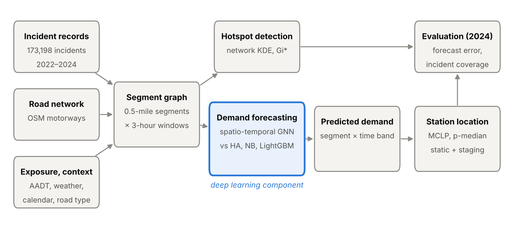

# Manuscript draft

**Locating freeway service patrol stations with deep spatio-temporal incident forecasting: a predict-then-optimise study of FDOT District 2, Northeast Florida**

Pascal Antwi¹, [Co-author] Sando²
¹ [Affiliation] · ² [Affiliation] · Corresponding author: [name, email]

*Outline draft, 21 October 2026. Sections are bullet outlines to be written up. [Section 4 (Exploratory data analysis)](#sec-4) is drafted in full; modelling methods ([Section 5](#sec-5)) and results ([Section 6](#sec-6)) are planned. All figures and tables are in the appendices: [Appendix A](#appendix-a-figures) (figures), [Appendix B](#appendix-b-tables) (tables), [Appendix C](#appendix-c-supplementary-material) (supplementary).*

**Terminology.** The data are traffic management events, not Road Ranger dispatch records. "Incidents" means events of the four types Road Rangers serve (disabled vehicle, crash, debris on roadway, abandoned vehicle); whether a Road Ranger responded to a given incident is not recorded.

---

## Abstract (outline, about 250 words; write last)

- **Background:** freeway service patrols such as Road Rangers cut clearance time and secondary crashes, but station locations are rarely derived from incident data.
- **Objective:** forecast where and when incidents occur, and locate patrol stations to maximise timely coverage.
- **Data:** 9.2 million traffic management records (2022–2024, FDOT District 2) reconstructed into 227,196 events; 173,198 incidents.
- **Methods:** network hotspot detection; spatio-temporal graph neural network (GNN) forecasting against statistical and machine-learning baselines; maximal covering and p-median models fed with predicted demand; evaluation on 2024.
- **EDA findings:** 90.3% of incidents on five corridors; half in 14.8% of occupied 1 km cells; weekday 15:00–17:59 peak; crash events open about four times longer than other types.
- **Modelling results:** [to do] forecast accuracy vs baselines; recommended stations; coverage gain over the current layout.
- **Keywords:** freeway service patrol; traffic incident management; graph neural network; spatio-temporal forecasting; maximal covering location problem; Florida.

## 1. Introduction (outline)

1. **Problem.** Incidents cause non-recurrent congestion; each minute on the roadway raises secondary-crash risk [REF].
2. **Service patrols.** Road Rangers' role in FDOT's traffic incident management; evidence of benefits [REF].
3. **Gap.** Station locations follow practice. Hotspot studies stop at the map, and forecasting studies stop at accuracy metrics without testing whether forecasts improve deployment decisions.
4. **Aim and objectives.** (i) Characterise incident patterns; (ii) forecast incident demand on the network with deep learning; (iii) optimise station locations with forecast demand; (iv) test whether forecast-driven layouts cover more future incidents than historical-demand and current layouts.
5. **Contribution.** A predict-then-optimise framework evaluated on a decision metric (incidents covered), not only forecast error, plus an assessment of detection bias in patrol-generated records.
6. **Paper structure.**

## 2. Literature review (outline, 40–60 references)

### 2.1 Freeway service patrols
- Effects on detection, response and clearance; secondary crashes; benefit–cost evaluations [REF].

### 2.2 Incident hotspot detection
- Network vs planar kernel density (Xie and Yan, 2008; Okabe et al., 2009); Gi* (Getis and Ord, 1992); counts vs exposure-based rates.

### 2.3 Deep learning for traffic and incident forecasting
- Spatio-temporal graph models: DCRNN (Li et al., 2018), STGCN (Yu et al., 2018), Graph WaveNet (Wu et al., 2019).
- Accident risk prediction under sparsity: Hetero-ConvLSTM (Yuan et al., 2018) [add recent incident/crash risk studies].
- Evidence that gradient boosting (Ke et al., 2017) is a strong baseline on sparse tabular data.

### 2.4 Facility location for emergency response
- Set covering (Toregas et al., 1971), maximal covering (Church and ReVelle, 1974), p-median (Hakimi, 1964); time-varying and predict-then-optimise approaches [REF].

### 2.5 Research gap
- No study links network incident forecasts from deep learning to service-patrol station siting and evaluates the result on held-out incidents.

## 3. Data (outline)

### 3.1 Study area 
- FDOT District 2: 15 counties; Jacksonville, Gainesville, Lake City; I-75, I-95, I-10, I-295 beltway → [Figure 1](#figure-1).

### 3.2 Incident data 
- Traffic management event chronology export, 1 Jan 2022 – 31 Dec 2024; one record per update to an event [REF: data owner, permission].
- Processing: duplicates removed; timestamps parsed in UTC and converted to Eastern time; coordinates rescaled from micro-degrees; points outside Florida removed; one row per event (type and conditions from the first record, location from the latest); roadway text parsed into county, route, direction, mile marker; duration = first to last update, with < 1 min and > 24 h flagged.
- Analysis sample: the four types Road Rangers serve → [Table 1](#table-1).

### 3.3 Supplementary data 
- Road network: OpenStreetMap (Boeing, 2017). Traffic volume: FDOT AADT. Weather: NOAA hourly observations. Holidays: federal and state calendar.
- Candidate station sites: interchanges, rest areas, FDOT facilities. Current Road Ranger stations and beats: FDOT District 2 [to obtain].

## 4. Exploratory data analysis 

Incidents were aggregated by month, weekday and hour, and mapped to a 1 km grid (incidents per year, crash share and most frequent location per cell) and to hexagonal density bins on a logarithmic scale. Candidate covariates were screened for completeness and variation.

### 4.1 Sample characteristics 

Between 1 January 2022 and 31 December 2024, 227,196 unique events were recorded in District 2, reconstructed from 9,206,764 chronology records ([Table 1](#table-1)). The four incident types served by Road Rangers made up 173,198 events (76.2%). The remaining events were traffic-management notices, chiefly congestion (22,053), scheduled road work (12,658) and bridge openings (4,392) ([Figure S1](#figure-s1)). Disabled vehicles were the most frequent type (58.9%), followed by crashes (25.5%), debris (9.8%) and abandoned vehicles (5.8%) ([Table 2](#table-2)). Annual totals varied by less than 7% (56,450 to 59,981), with no sustained trend in any type ([Figure S2](#figure-s2)).

**Interpretation.** Patrol-relevant demand is dominated by non-crash assistance: disabled vehicles outnumber crashes by more than two to one ([Table 2](#table-2)), so planning from crash data alone would miss most of the workload. The stability in [Figure S2](#figure-s2) supports training on 2022–2023 and testing on 2024 ([Section 5.6](#sec-5-6)).

### 4.2 Temporal patterns 

Weekdays accounted for 76.2% of incidents, and the mean daily count was 28% higher on weekdays than at weekends (168.7 vs 131.5) ([Table 2](#table-2)). Incidents peaked between 15:00 and 17:59 on weekdays, with a maximum on Fridays from 15:00 to 15:59 (14.7 per hour), against about two per hour between 01:00 and 04:59 ([Figure 2](#figure-2)). Crashes had a morning peak at 07:00 (5.9%) and a larger evening peak at 17:00 (9.0%). Debris showed a midday plateau (09:00–16:00), and abandoned vehicles clustered at 07:00–08:59 (24.6%) ([Figure S3](#figure-s3)).

**Interpretation.** The afternoon peak in [Figure 2](#figure-2) coincides with commuter traffic, consistent with exposure rather than time of day driving occurrence. The roughly sevenfold gap between overnight and peak demand motivates time-of-day forecasting and band-specific staging ([Sections 5.2](#sec-5-2) and [5.5](#sec-5-5)). The morning spike in abandoned vehicles ([Figure S3](#figure-s3)) most plausibly reflects detection on first patrols rather than when vehicles were abandoned.

### 4.3 Spatial distribution and concentration 

Incidents were confined to the limited-access network and concentrated around Jacksonville ([Figure 1](#figure-1)a); Duval County accounted for 53.2%. Five routes, I-75 (26.3%), I-95 (22.3%), I-10 (18.5%), I-295 W (14.4%) and I-295 E (8.8%), carried 90.3% ([Figure S4](#figure-s4)). Crashes made up 34.8% of incidents on I-95 but 8.9% on I-75, where disabled vehicles accounted for 76.0%. Of the 983 occupied 1 km cells, 145 (14.8%) contained half of all incidents, and the 15 busiest contained 9.9% ([Figure 3](#figure-3)). Fourteen of the top 15 cells lie in central Jacksonville in four clusters: the Buckman Bridge (I-295 W), the I-95/I-10 interchange, I-95 at Butler Boulevard and I-295 E at Butler Boulevard ([Figure 1](#figure-1)b). Interchange cells had crash shares of 40–48%, whereas bridge and rural cells (the Buckman Bridge and I-75 near Gainesville) had 6–11% ([Figure 3](#figure-3)).

**Interpretation.** The concentration in [Figure 3](#figure-3) is the precondition for coverage-based siting: a few stations can reach a large share of demand. The contiguous clusters in [Figure 1](#figure-1)b suggest each cluster acts as one service zone, and spatial dependence between neighbouring segments is what a graph model is designed to exploit ([Section 5.4](#sec-5-4)). Crash-dominated interchanges call for rapid clearance; bridge and rural hotspots call for fast removal. These planar results are descriptive; network significance and AADT normalisation follow in [Section 6.1](#sec-6-1).

### 4.4 Event duration 

The median event duration was 18.9 minutes (IQR 5.7–45.6) ([Table 2](#table-2)). Crash events remained open for a median of 56.7 minutes, about four times longer than disabled vehicles (13.4) and debris (12.8); abandoned vehicles were shortest at 4.7 minutes ([Figure 4](#figure-4)). The 5,189 flagged events (3.0%) were excluded ([Table 1](#table-1)).

**Interpretation.** Crash events occupy units about four times longer ([Figure 4](#figure-4)), so crash-dominated hotspots consume more capacity than their counts imply, which motivates a duration-weighted demand scenario ([Section 5.6](#sec-5-6)). Duration is a log-based proxy for how long an event stayed open, not on-scene clearance time.

### 4.5 Data quality and detection 

Half of all incidents (49.8%) were created by the account `avlrrsubsystem`, which appears to be the Road Ranger automatic vehicle location (AVL) subsystem [to confirm with FDOT] ([Table S1](#table-s1)). Its share ranged from 4.9% of crashes to 86.8% of abandoned vehicles ([Table 2](#table-2)), and from 35% on I-95 to 73% on I-75. Severity was recorded as minor for 99.9% of incidents, pavement as dry for 98.8% and weather as clear for 98.3%; mile markers were missing for 53.0% ([Table S1](#table-s1)).

**Interpretation.** If confirmed as patrol-generated, the AVL share in [Table 2](#table-2) means many non-crash incidents are discovered by patrols themselves, so recorded demand may partly mirror existing patrol coverage (detection bias); crashes, rarely AVL-created, are less exposed. Models will therefore be re-run without these records ([Section 5.6](#sec-5-6)). The near-constant severity and weather fields in [Table S1](#table-s1) are dropped; weather enters the models from NOAA instead ([Section 3.3](#sec-3-3)).

## 5. Methodology: modelling (outline) 

### 5.1 Framework 
- Predict-then-optimise pipeline → [Figure 5](#figure-5): build a segment graph, detect hotspots, forecast demand, optimise stations, evaluate on 2024.

### 5.2 Spatial and temporal units 
- Nodes: directional 0.5-mile segments of the limited-access network; incidents snapped to the nearest segment (flag snaps > 200 m).
- Edges: network connectivity (upstream/downstream, interchange links), weighted by travel time.
- Time: 3-hour windows (8 per day, 8,768 over three years); target *yₛ,ₜ* = incidents on segment *s* in window *t* (total, and crash vs non-crash).
- Rationale: under 0.01 incidents per segment-hour; 3-hour windows reduce zero inflation.

### 5.3 Hotspot detection 
- Network KDE (Okabe et al., 2009) for continuous intensity.
- Gi* on segment counts and on rates per million vehicle-miles (AADT), with false discovery rate correction (Benjamini and Hochberg, 1995); year-by-year persistence.

### 5.4 Demand forecasting with deep learning 
- **Task:** given the previous *L* windows and context, predict expected counts *λₛ,ₜ₊₁…ₜ₊ₕ* for all segments (day ahead, *H* = 8).
- **Inputs** → [Table S2](#table-s2): lagged counts by type; calendar (window, weekday, holiday, month); static segment attributes (AADT, interchange, bridge, urban/rural, speed limit); NOAA precipitation.
- **Deep learning model:** spatio-temporal GNN (Graph WaveNet or STGCN) with a Poisson or zero-inflated Poisson loss for sparse counts.
- **Baselines:** historical average (segment × window), negative binomial regression, LightGBM with a Poisson objective on the same inputs.
- **Ablations:** no graph (LSTM per segment, shared weights); no weather; no AVL-created incidents.
- **Training:** 2022 – Sep 2023 train; Oct–Dec 2023 validation (early stopping, hyperparameter search); 2024 test; five random seeds.
- **Metrics:** MAE, RMSE, Poisson deviance; hit rate and predictive accuracy index (PAI; Chainey et al., 2008) for the top-*k*% segments.
- **Interpretation of models:** SHAP for LightGBM (Lundberg and Lee, 2017); input ablation for the GNN.

### 5.5 Station location optimisation 
- Demand *aᵢᵇ*: predicted incidents per year on segment *i* in time band *b* (AM peak, midday, PM peak, night, weekend).
- Maximal covering location problem (Church and ReVelle, 1974):

$$
\max \sum_{b} \sum_{i \in I} a_i^b y_i^b \quad \text{s.t.} \quad \sum_{j \in N_i^b} x_j \ge y_i^b \;\; \forall i, b, \qquad \sum_{j \in J} x_j = p, \qquad x_j, y_i^b \in \{0, 1\},
$$

  where *Nᵢᵇ* is the set of candidate sites within response time *T* of segment *i* under band-*b* travel speeds.
- Variants: static stations (above); band-specific staging points; p-median (Hakimi, 1964) for mean response time.
- Solved as a mixed-integer program (PuLP/CBC); travel times from network shortest paths.

### 5.6 Evaluation design 
- **Forecast quality:** metrics in [Section 5.4](#sec-5-4) on 2024.
- **Decision quality:** share of actual 2024 incidents covered within *T* = 10, 15, 20 minutes, and mean response time, for layouts built from (i) current stations, (ii) historical-average demand, (iii) LightGBM demand, (iv) GNN demand.
- **Sensitivity:** segment length, window length, *p*, *T*, demand weights (count, crash-only, duration-weighted), exclusion of AVL-created incidents.

## 6. Modelling results (outline, to do) 

### 6.1 Network hotspots 
- Method: [Section 5.3](#sec-5-3). Significant hot segments on counts vs rates → [Figure 6](#figure-6); persistence across years → [Figure S5](#figure-s5).
- Agreement with the EDA clusters ([Section 4.3](#sec-4-3)).

### 6.2 Forecasting performance 
- GNN vs baselines → [Table 3](#table-3).
- Error by time band and segment type; predicted vs observed 2024 hotspots → [Figure 7](#figure-7).
- Does the graph help? (ablation rows in [Table 3](#table-3)).

### 6.3 Station locations and coverage 
- Coverage vs number of stations, by demand source → [Figure 8](#figure-8).
- Recommended vs current stations → [Figure 9](#figure-9); layout comparison → [Table 4](#table-4).

### 6.4 Sensitivity 
- Robustness to units, *p*, *T*, weights and AVL exclusion → [Figure S6](#figure-s6).

## 7. Discussion (outline)

### 7.1 Implications for station siting
- Stable, concentrated, time-dependent demand ([Sections 4.1](#sec-4-1)–[4.3](#sec-4-3)) favours data-driven siting; central Jacksonville focus, I-75 near Gainesville as the leading rural candidate.
- Plan location and unit capability together (crash vs assistance hotspots).
- [to do] What the recommended layout changes and gains.

### 7.2 When does deep learning pay off?
- Accuracy gain over LightGBM vs added complexity; whether accuracy gains translate into coverage gains ([Table 3](#table-3) vs [Table 4](#table-4)).

### 7.3 Limitations
- One district; detection bias ([Section 4.5](#sec-4-5)); log-based duration ([Section 4.4](#sec-4-4)); modelled, not observed, response times; incidents are not confirmed Road Ranger responses.

### 7.4 Future work
- Real-time dynamic staging; dispatch data; other districts.

## 8. Conclusion (outline)

- Three to four sentences: demand pattern, forecast performance, recommended stations and coverage gain, policy takeaway.

## Declarations (outline)

- Data and code availability; author contributions (CRediT); funding; competing interests.

## References

*Starting list; verify every entry. [REF] markers still need sources.*

- Benjamini, Y., Hochberg, Y., 1995. Controlling the false discovery rate: a practical and powerful approach to multiple testing. *Journal of the Royal Statistical Society: Series B* 57(1), 289–300.
- Boeing, G., 2017. OSMnx: new methods for acquiring, constructing, analyzing, and visualizing complex street networks. *Computers, Environment and Urban Systems* 65, 126–139.
- Chainey, S., Tompson, L., Uhlig, S., 2008. The utility of hotspot mapping for predicting spatial patterns of crime. *Security Journal* 21, 4–28.
- Church, R., ReVelle, C., 1974. The maximal covering location problem. *Papers of the Regional Science Association* 32, 101–118.
- Getis, A., Ord, J.K., 1992. The analysis of spatial association by use of distance statistics. *Geographical Analysis* 24(3), 189–206.
- Hakimi, S.L., 1964. Optimum locations of switching centers and the absolute centers and medians of a graph. *Operations Research* 12(3), 450–459.
- Ke, G., Meng, Q., Finley, T., et al., 2017. LightGBM: a highly efficient gradient boosting decision tree. *Advances in Neural Information Processing Systems* 30.
- Li, Y., Yu, R., Shahabi, C., Liu, Y., 2018. Diffusion convolutional recurrent neural network: data-driven traffic forecasting. *International Conference on Learning Representations (ICLR)*.
- Lundberg, S.M., Lee, S.-I., 2017. A unified approach to interpreting model predictions. *Advances in Neural Information Processing Systems* 30.
- Okabe, A., Satoh, T., Sugihara, K., 2009. A kernel density estimation method for networks, its computational method and a GIS-based tool. *International Journal of Geographical Information Science* 23(1), 7–32.
- Toregas, C., Swain, R., ReVelle, C., Bergman, L., 1971. The location of emergency service facilities. *Operations Research* 19(6), 1363–1373.
- Wu, Z., Pan, S., Long, G., Jiang, J., Zhang, C., 2019. Graph WaveNet for deep spatial-temporal graph modeling. *Proceedings of IJCAI*, 1907–1913.
- Xie, Z., Yan, J., 2008. Kernel density estimation of traffic accidents in a network space. *Computers, Environment and Urban Systems* 32(5), 396–406.
- Yu, B., Yin, H., Zhu, Z., 2018. Spatio-temporal graph convolutional networks: a deep learning framework for traffic forecasting. *Proceedings of IJCAI*, 3634–3640.
- Yuan, Z., Zhou, X., Yang, T., 2018. Hetero-ConvLSTM: a deep learning approach to traffic accident prediction on heterogeneous spatio-temporal data. *Proceedings of ACM SIGKDD*, 984–992.

---

## Appendix A. Figures

**Figure 1.** Spatial distribution of incidents in FDOT District 2, 2022–2024. (a) District overview; the dashed box marks panel (b). (b) Central Jacksonville; red circles mark 14 of the 15 busiest 1 km grid cells (the 15th lies on I-75 near Gainesville). Hexagon shading shows incident counts on a logarithmic scale.

*Referenced in [Section 3.1](#sec-3-1), [Section 4.3](#sec-4-3).*

**Figure 2.** Mean number of incidents per hour, by hour of day and day of week, 2022–2024.

*Referenced in [Section 4.2](#sec-4-2).*

**Figure 3.** The 15 one-kilometre grid cells with the highest mean annual number of incidents. Labels give the most frequent location description in each cell; annotations give incidents per year and the share of crashes. Rows 3 and 4 are adjacent cells on the Buckman Bridge.

*Referenced in [Section 4.3](#sec-4-3).*

**Figure 4.** Event duration (first to last log update) by incident type. Boxes show the interquartile range, the vertical line the median and whiskers the 5th–95th percentiles; logarithmic scale. Events shorter than 1 minute or longer than 24 hours are excluded (n = 5,189).

*Referenced in [Section 4.4](#sec-4-4).*

**Figure 5.** Study framework. Incident, network and context data form a segment-by-time graph used for hotspot detection and demand forecasting (deep learning component highlighted); predicted demand feeds the station location models, and all outputs are evaluated on 2024 incidents. HA: historical average; NB: negative binomial; MCLP: maximal covering location problem.

*Referenced in [Section 5.1](#sec-5-1).*

**Figure 6.** [to do] Network hotspots: (a) network KDE; (b) Gi* hot and cold segments on counts; (c) on AADT-based rates. *Referenced in [Section 6.1](#sec-6-1).*

**Figure 7.** [to do] Forecast performance: (a) error by time band for each model; (b) predicted vs observed 2024 incidents by segment. *Referenced in [Section 6.2](#sec-6-2).*

**Figure 8.** [to do] Share of 2024 incidents covered within 10, 15 and 20 minutes against number of stations, by demand source. *Referenced in [Section 6.3](#sec-6-3).*

**Figure 9.** [to do] Recommended and current Road Ranger station locations with coverage areas. *Referenced in [Section 6.3](#sec-6-3).*

## Appendix B. Tables

**Table 1.** Data processing summary.

*Referenced in [Section 3.2](#sec-3-2), [Section 4.1](#sec-4-1), [Section 4.4](#sec-4-4).*

| Stage | Records | Note |
| --- | ---: | --- |
| Raw chronology records (`Incidents.csv`) | 9,206,764 | One row per update to an event |
| Records retained after cleaning | 9,206,301 | 463 removed: missing identifier, invalid timestamp, coordinates outside Florida, duplicates [per-reason counts pending] |
| Unique events | 227,196 | One row per event; median 30 updates per event |
| Incidents (analysis sample) | 173,198 | Disabled vehicle, crash, debris, abandoned vehicle (76.2% of events) |
| Excluded from duration analysis only | 5,189 | Duration < 1 min (1,257) or > 24 h (3,932) |
| Study period and area | 1 Jan 2022 – 31 Dec 2024 | 15 counties, FDOT District 2 |

**Table 2.** Characteristics of incidents by type, FDOT District 2, 2022–2024.

*Referenced in [Sections 4.1](#sec-4-1), [4.2](#sec-4-2), [4.4](#sec-4-4), [4.5](#sec-4-5).*

| Incident type | n | % | 2022 | 2023 | 2024 | Median duration, min (IQR) | Weekday % | 15:00–17:59 % | AVL-created % |
| --- | ---: | ---: | ---: | ---: | ---: | --- | ---: | ---: | ---: |
| Disabled vehicle | 101,933 | 58.9 | 33,260 | 32,828 | 35,845 | 13.4 (4.9–31.7) | 75.4 | 23.0 | 67.9 |
| Crash | 44,158 | 25.5 | 14,401 | 15,013 | 14,744 | 56.7 (29.9–88.2) | 77.4 | 25.3 | 4.9 |
| Debris on roadway | 16,979 | 9.8 | 5,822 | 5,529 | 5,628 | 12.8 (3.8–28.6) | 78.0 | 22.1 | 36.3 |
| Abandoned vehicle | 10,128 | 5.8 | 3,284 | 3,080 | 3,764 | 4.7 (3.0–9.9) | 75.0 | 12.5 | 86.8 |
| **All** | **173,198** | **100.0** | **56,767** | **56,450** | **59,981** | **18.9 (5.7–45.6)** | **76.2** | **22.9** | **49.8** |

*Note:* Duration excludes 5,189 flagged events ([Table 1](#table-1)). AVL-created: event created by the `avlrrsubsystem` account. IQR: interquartile range.

**Table 3.** [to do] Forecast performance on 2024 incidents (mean ± s.d. over five seeds).

*Referenced in [Section 6.2](#sec-6-2), [Section 7.2](#72-when-does-deep-learning-pay-off).*

| Model | MAE | RMSE | Poisson deviance | Hit rate, top 5% segments | PAI |
| --- | --- | --- | --- | --- | --- |
| Historical average | | | | | |
| Negative binomial | | | | | |
| LightGBM | | | | | |
| LSTM (no graph; ablation) | | | | | |
| Spatio-temporal GNN | | | | | |

**Table 4.** [to do] Station layouts evaluated on actual 2024 incidents.

*Referenced in [Section 6.3](#sec-6-3), [Section 7.2](#72-when-does-deep-learning-pay-off).*

| Layout (demand source) | Stations | Covered ≤ 10 min (%) | ≤ 15 min (%) | ≤ 20 min (%) | Mean response time (min) |
| --- | --- | --- | --- | --- | --- |
| Current stations | | | | | |
| Historical average | | | | | |
| LightGBM | | | | | |
| Spatio-temporal GNN | | | | | |

## Appendix C. Supplementary material

**Figure S1.** Frequency of all recorded event types, 2022–2024. Blue bars mark the four incident types analysed; grey bars are traffic-management events excluded from the analysis.

*Referenced in [Section 4.1](#sec-4-1).*

**Figure S2.** Monthly number of incidents by type, January 2022 – December 2024.

*Referenced in [Section 4.1](#sec-4-1).*

**Figure S3.** Hourly distribution of incidents within each type, as a percentage of the type's total.

*Referenced in [Section 4.2](#sec-4-2).*

**Figure S4.** Incidents by route and type for the eight routes with the most incidents, 2022–2024.

*Referenced in [Section 4.3](#sec-4-3).*

**Figure S5.** [to do] Hotspot persistence by year (emerging hotspot categories). *Referenced in [Section 6.1](#sec-6-1).*

**Figure S6.** [to do] Sensitivity of forecasts and station solutions to segment length, window length, number of stations, response-time standard, demand weights and exclusion of AVL-created incidents. *Referenced in [Section 6.4](#sec-6-4).*

**Table S1.** Completeness and variability of candidate explanatory variables (incidents, n = 173,198).

*Referenced in [Section 4.5](#sec-4-5).*

| Indicator | Share of incidents (%) |
| --- | ---: |
| Severity recorded as "minor" | 99.9 |
| Road surface "Dry" | 98.8 |
| Weather "Clear" | 98.3 |
| Lighting code 16 (code meaning undocumented) | 91.7 |
| Mile marker missing | 53.0 |
| Created by the `avlrrsubsystem` account | 49.8 |
| Duration > 24 h (flagged) | 2.3 |
| Duration < 1 min (flagged) | 0.7 |

**Table S2.** Model inputs. [to do: add the final hyperparameters for each model after tuning.]

*Referenced in [Section 5.4](#sec-5-4).*

| Input | Description | Source |
| --- | --- | --- |
| Lagged counts | Incidents per segment in the previous *L* windows, by type | Incident data |
| Time window | One of eight 3-hour windows | Derived |
| Day of week, holiday, month | Calendar indicators | Derived; federal/state calendar |
| AADT | Annual average daily traffic on the segment | FDOT |
| Segment type | Interchange, bridge, urban/rural | OpenStreetMap |
| Speed limit | Posted speed | OpenStreetMap |
| Precipitation | Hourly precipitation at the nearest station | NOAA |
| Graph adjacency | Travel-time-weighted connections between segments (GNN only) | OpenStreetMap |
